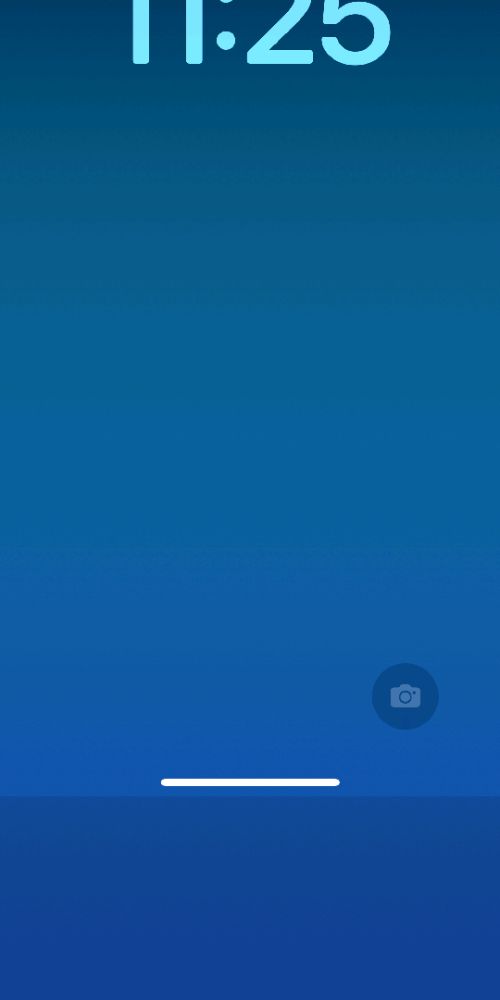
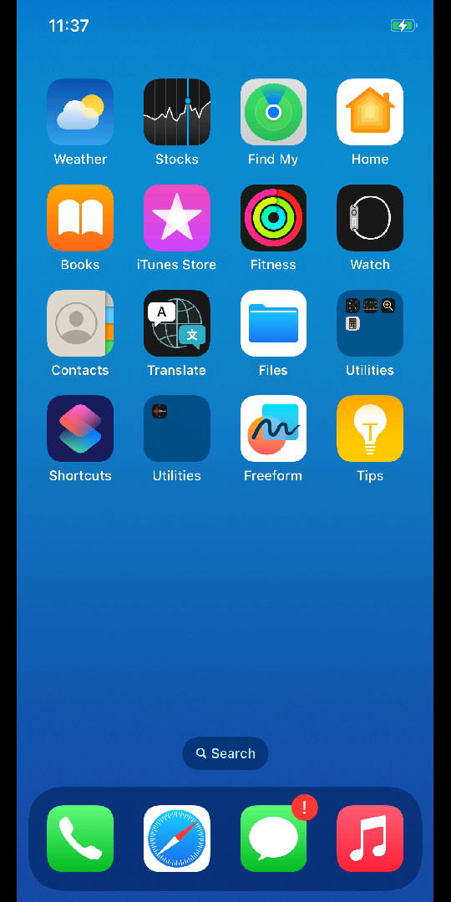
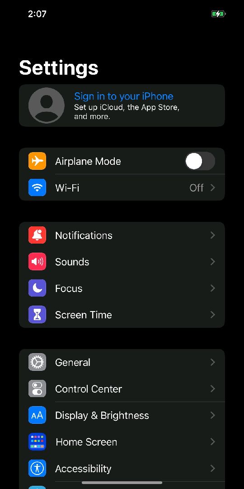
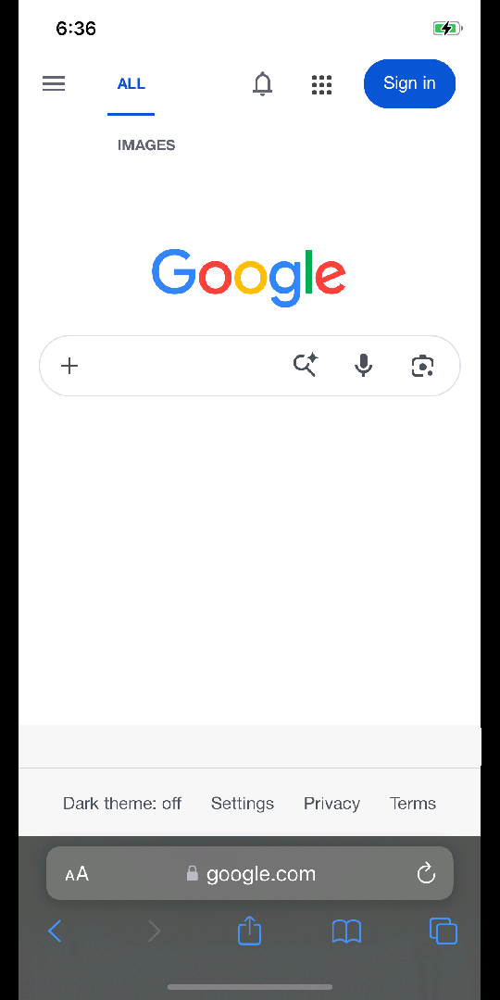

# pixel3-ios

> **Independently maintained.** This project started as a fork of
> **[erikkunz/pixel3-ios](https://github.com/erikkunz/pixel3-ios)** by Erik Kunz
> ([@erikkunz](https://github.com/erikkunz)), who did the original port to the Pixel 3 and wrote most of the
> README below. It is now developed here on its own. The main additions are the Adreno 630 GPU, a GPU-drawn
> iOS UI, zero-copy display flips and more board support. Thanks to Erik for the foundation, and to
> [ios-sweet](https://github.com/dipa-studio/ios-sweet) and HakiOS (the EAGL shim in `gpu/eagl-ios`, MIT), and to
> [ios-topaz](https://github.com/MakrSas/ios-topaz) and HackiOS (the Wi-Fi station, `en0` and Apple80211, APSL 2.0)
> and [ios-flame](https://github.com/NWylynko/ios-flame) (USB live log, MIT).
> Please report problems [here](https://github.com/andyleenz/pixel3-ios/issues).

<p>




</p>

**New since the fork (2026-11):**
- **Wi-Fi works in iOS.** Join a 2.4 GHz WPA2 network from Settings (the password typed on the phone), get
  an address by DHCP, and browse in Safari. The WCN3990 radio, its WPA2 handshake and `en0` run in our kernel;
  wifid and configd are Apple's own.
- **USB live channel.** With `sweetusb=2` the phone is a USB network adapter: the kernel log streams to the
  Mac live, and `tools/bluesh.py` runs programs and swaps files on the running phone (a userland change takes
  seconds instead of a reboot).
- The UI is drawn by the Adreno 630 at about 60 fps (`blueui=1`). CoreAnimation runs over Mesa freedreno
  ([`gpu/`](gpu/README.md)).
- The display scans out iOS's own buffers, triple-buffered, with flips that wait for the GPU in the kernel.
- The first-boot migration installs all the stock apps (Weather, Wallet, Contacts, Files, Shortcuts...),
  and the wallpaper, lock screen and widgets work.
- Brightness, haptics, battery gauge, RTC, CPU clocks and thermal limits, watchdog, modem boot.
- A hands-off test loop with scripted touches and screenshots ([docs/TESTING.md](docs/TESTING.md)). The
  engineering log is on the [`linux-host`](https://github.com/andyleenz/pixel3-ios/blob/linux-host/docs/LOG.md)
  branch.

**Apple's iOS 16 running on a Google Pixel 3.**

A port of [ios-sweet](https://github.com/dipa-studio/ios-sweet) to the Pixel 3 (`blueline`, Qualcomm
SDM845 / Snapdragon 845, Adreno 630). Apple's open-source XNU kernel (xnu-8796, the iOS 16 generation), with
ios-sweet's patches and the Pixel 3 ones on top, runs the **unmodified iOS 16.7.16 (20H392) userland of the
iPhone X**. Google's own bootloader starts it like a Linux kernel; the iOS root lives in the `userdata`
partition.

> Experimental bring-up, not a usable phone OS. It **erases Android's user data**, Apple's security model is
> mostly switched off (permissive AMFI and sandbox, a stand-in keystore), and much is missing. Do not put
> anything personal on it. No Apple software is stored in this repository: the iOS root is built on your own
> Mac from Apple's IPSW. Not affiliated with or endorsed by Apple or Google.

## What works (2026-11-20)

| Area | State |
| --- | --- |
| Boot | Google ABL (unlocked) starts our shim, which loads XNU with an Apple device tree. Test kernels go in with `fastboot boot`; a kernel flashed to `boot_a` starts at power-on, while slot B keeps LineageOS and its recovery |
| CPU | All 8 cores (4x Kryo 385 Silver at 1.77 GHz, 4x Gold at 2.65 GHz), PSCI |
| Storage | UFS; the iOS root is an HFS+ image on `userdata`, read/write. Changes go to the phone as small sparse diffs (seconds) |
| Display | The 1080x2160 command-mode panel ABL leaves running. iOS sees an iPhone X 1125 pixels wide at the panel's 2:1 (1125x2250, scaled by 0.96 to fill the panel; 0184), with the X's status bar. With `blueui=1` the DPU scans out iOS's own buffers (triple-buffered, flips wait for the GPU) at 60 Hz; without it, a CPU copy at 30 Hz. Brightness works |
| GPU | Adreno 630 under Mesa freedreno (GLES 3.2); CoreAnimation draws through it via an EAGL shim. Settings and Safari scroll at 55-62 fps |
| iOS | Data migration with all 32 removable stock apps, wallpaper (PosterBoard) on the lock and home screens, widgets, SpringBoard, Settings, Safari. the App Library and Control Center blurs, Control Center's glyphs and brightness slider. Photos crashes (no photo library yet), and parts of Control Center blink while it animates |
| Touch | ST FTM5 over bit-banged I2C (the QUP's GPI DMA path is not usable yet), its 3.3 V supply asked for over RPMh, interrupt-driven, edge gestures (home, app switcher) |
| Buttons | Power, volume up and down (SPMI PMIC) |
| Battery, clocks | Fuel gauge readings, RTC (time of day), CPU frequency and thermal limits, watchdog |
| Wi-Fi | **Works in iOS on 2.4 GHz.** The WCN3990's firmware runs in the modem's WLAN domain (copy engines, HTC/WMI/HTT). Settings lists the networks nearby; joining a WPA2 network with the password typed on the phone associates, does the 4-way handshake in the kernel, gets a DHCP address, and Safari loads pages. `en0` and Apple80211 (ported from ios-topaz/HackiOS) serve Apple's own wifid and configd. 5 GHz scans don't start yet |
| Other | Haptics, modem boot (no cellular data yet) |
| USB | Device mode (DWC3, CDC-ECM) with `sweetusb=2`: a live kernel log, file and command servers, and `bluesh` for running programs on the phone |
| Logs | The kernel console in a ring on `userdata`, read from LineageOS recovery, or live over USB |

**Not working yet:** Metal, 5 GHz Wi-Fi, audio, camera, Bluetooth, cellular data, sensors, Face ID / SEP (and so
FairPlay: App Store apps).

## Roadmap

Updated as work lands. The detail is in the [engineering log](https://github.com/andyleenz/pixel3-ios/blob/linux-host/docs/LOG.md).

**In progress: smoothness**
- Remove the remaining hitches (frames of 30-120 ms when a screen or app first appears). Measured causes:
  IOSurfaces whose rows aren't 64-byte aligned are copied by the CPU instead of read by the GPU in place
  (up to 9 ms per full-screen copy); texture uploads; first-use shader compiles (now cached on disk).
- GMEM (on-chip tile) rendering instead of sysmem, for the blur-heavy screens (dock, Control Center).

**In progress: Wi-Fi**
- 5 GHz scans and joins; make the radio part of the default boot; WPA3 and open networks; Wi-Fi off/on
  from Control Center without a stall.

**Next**
- Make the GPU path (`blueui=1`) the default boot.
- Photos: find out why it sees no photo library (assetsd never starts).
- GPU memory: a larger BO pool than 32 MiB, and a 4th scanout buffer.
- Widgets ("Waiting..."), GPU clock scaling (DCVS).

**Later**
- Audio, display power-off on lock.
- iPadOS 18 (the iPad 7's arm64 build, with the phone home-screen layout switched on by feature flags):
  a newer kernel generation and a re-port of our patches. Suggested in erikkunz/pixel3-ios#1.
- Metal: a much larger project (no Apple GPU driver to stand on).

**Why iOS 16:** every iOS for newer iPhones is built for arm64e, which uses ARMv8.3 pointer authentication.
The Pixel 3's cores are ARMv8.2 and have none, so iOS 16 for the iPhone X (plain arm64) is the newest *iPhone*
iOS that can run natively here. iPadOS 18 for the iPad 7 (A10, also plain arm64) is newer and could run too
(see Roadmap).

## How it boots

```
ABL (Google's bootloader, unlocked)
  -> shim (p2-shim/): a gzip'd arm64 Image + the stock DTB, header v1
       checks memory and the carve-outs, sets up the payload and jumps to XNU
  -> XNU (xnu/patches + ios-sweet's patches, built in CI)
       built-in drivers: UFS, framebuffer, touch, keys, cpufreq, RPMh, USB, battery
  -> launchd and the iPhone X userland from userdata (rd=ufsroot0)
```

## Repository

| Path | What |
| --- | --- |
| `p1-probe/` | Bare-metal probe: display, memory map, SMP and timer checks |
| `p2-shim/` | The shim ABL boots, which carries the XNU payload; QEMU test |
| `p3-input/` | Input probe: SPMI keys, touch (bit-banged I2C, RPMh LDO vote, FTM5 start-up), GPI/SMMU experiments |
| `common/` | Shared start-up, framebuffer console, FDT and build code |
| `xnu/patches/` | Our kernel patches (0100-0122) on top of ios-sweet's |
| `.github/workflows/xnu.yml` | Builds the kernel on GitHub's macOS runners: fetches ios-sweet, ios-sailfish and ios-flame code at pinned commits and applies ours |
| `tools/` | Device tree (`mkadt.py`) and payload, boot images, the iOS root (`mkiosroot.sh`, `iosroot-tweaks.py`), sparse diffs (`simgdiff.py`), phone access (`phone.sh`, `fbboot.sh`), preference fixes, USB tools |
| `dtb/` | The mainline blueline DTB used by the first probes |
| [docs/LOG.md](docs/LOG.md) | The full engineering log: every step, measurement and dead end |

## Our kernel patches

| Patch | What |
| --- | --- |
| 0100-0102 | Early framebuffer, 8-core SMP, panel size |
| 0103, 0116 | SMP diagnostics (per-CPU timers, IPIs, scheduler and GIC state) |
| 0104, 0109 | Power and volume keys |
| 0105, 0113, 0114, 0118, 0121 | Touch: bit-banged I2C, LDO19 via RPMh, FTM5 start-up, edge gestures, interrupt-driven |
| 0106 | CPU frequency for both clusters |
| 0107 | Quiet IOAcceleratorES polling, IOKit quiesce (after ios-sailfish) |
| 0108, 0122 | USB: ios-sweet's and ios-flame's driver, adapted to SDM845 (clocks, QUSB2 PHY, SMMU stream 0x740) |
| 0111 | AppleKeyStore key wrap/unwrap, so securityd can write keychain items |
| 0112 | No set/way cache flush on idle (from HackiOS) |
| 0115 | iPhone X frame scaled to fit the panel; touch mapped to match |
| 0117 | Breaks user fault loops caused by stale table-walk entries (the cause of the 8-core boot stalls) |
| 0119, 0120 | Static battery registered as AppleSmartBattery |

## Building and running (macOS)

Rough outline; [docs/LOG.md](docs/LOG.md) has the details and the reasons.

1. **Phone:** Pixel 3 with an unlocked bootloader and LineageOS recovery in slot B. Back up first
   (`tools/backup-phone.sh`).
2. **Kernel:** `tools/build-xnu.sh` builds `kernel.development.sweet` locally on a Mac with Xcode 15.x installed
   next to your normal Xcode (`xcodes install 15.4`; no sudo, same pins as the workflow). The `xnu` workflow
   did the same on GitHub's `macos-14` runners, which have been retired; the newer images only have Xcode 16+,
   whose `iig` does not fit xnu-8796.
3. **Payload and shim:** `tools/mkadt.py` (the iPhone X device tree from the IPSW, plus the Pixel 3's
   CPUs, memory and display), `tools/mkpayload.py KERNEL ADT OUT --cmdline '...'`, then
   `p2-shim/build.sh PAYLOAD stock/boot.img`. Toolchain: `brew install llvm lld`.
4. **iOS root:** `sudo tools/mkiosroot.sh OS.dmg SYSTEMOS.dmg APPOS.dmg work/ios-root.img` from the
   iPhone X 16.7.16 IPSW, then sparse it (`tools/img2simg.py`) and `fastboot flash userdata` (this erases
   Android's data).
5. **Boot:** `tools/fbboot.sh p2-shim/out/shim.img`, or flash the shim to `boot_a` and
   `fastboot --set-active=a`. For logs, switch to slot B, boot recovery with ADB on, and run
   `tools/phone.sh log`.

## Credits

This builds directly on other people's work:

- [ios-sweet](https://github.com/dipa-studio/ios-sweet) (dipa-studio, MIT): the XNU port this is based on.
  Its patches and its USB driver are fetched at build time.
- [ios-flame](https://github.com/NWylynko/ios-flame) (Pixel 4, MIT): the USB driver, SMMU handling and USB
  host tools, the roadmap for GPU and Wi-Fi, and the WCN3990 HTT setup in the Wi-Fi radio (0172).
- [ios-topaz](https://github.com/MakrSas/ios-topaz) (Redmi Note 12 4G, kernel patches APSL 2.0): the WCN3990
  copy engines, HTC, WMI and scan (its 0123, ported in 0172).
- [ios-sailfish](https://github.com/joranv1/ios-sailfish) (Pixel 1): generic XNU fixes, GIC SPI support,
  touch-interrupt and performance ideas.
- [HackiOS](https://github.com/oosexgang/hackios-xnu-kernel) (OOSEX GANG,
  [userland](https://github.com/oosexgang/hackios-xnu-userland)): the idle-flush fix, the migration and
  daemon findings, and the bit-banging idea.
- [ios-raphael](https://github.com/Gsjsjzhznsz/ios-raphael): the ST FTS event format and the battery
  registration name.
- Linux (`gcc-sdm845.c`, `gpi.c`, `i2c-qcom-geni.c`, `cmd-db.c`, `rpmh-rsc.c`, `arm-smmu-qcom.c`, ath10k) and
  Google's Pixel 3 FTM5 driver, used as hardware references.

## License

[MIT](LICENSE) for the code in this repository. The kernel patches in `xnu/patches/` modify Apple's XNU, which
is under the Apple Public Source License 2.0; code taken from other ports keeps its credit and license (see
above).

Apple, iOS and iPhone are trademarks of Apple Inc.
