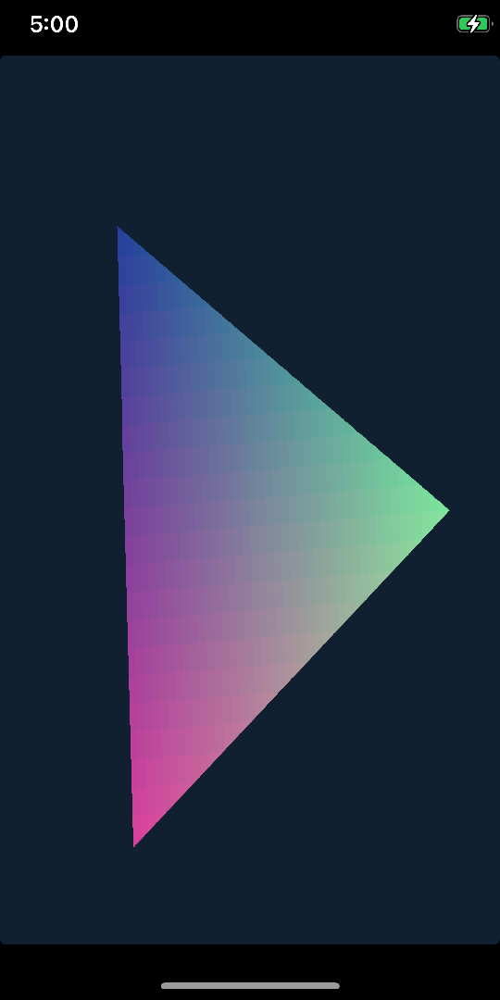
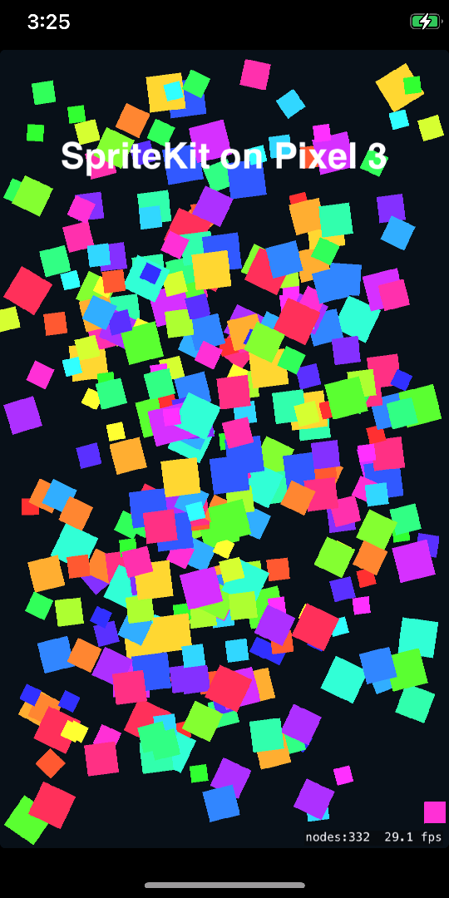
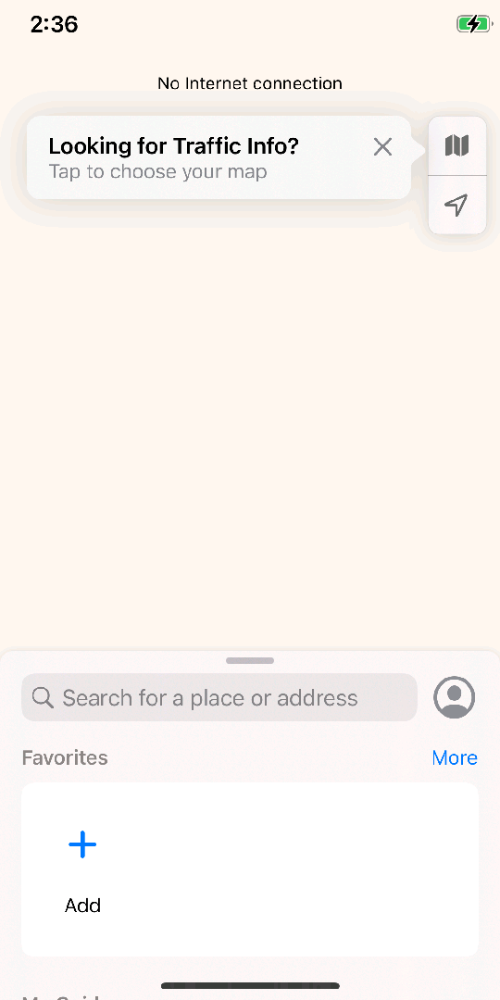
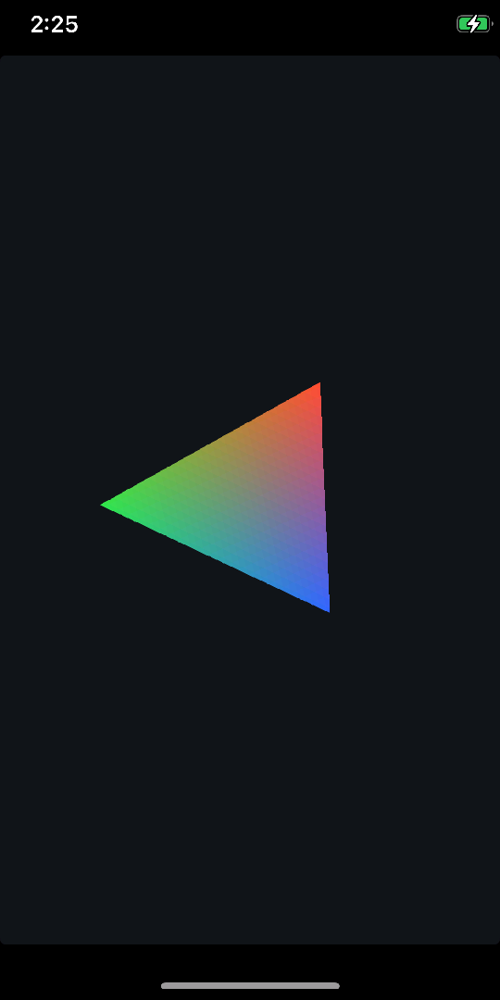
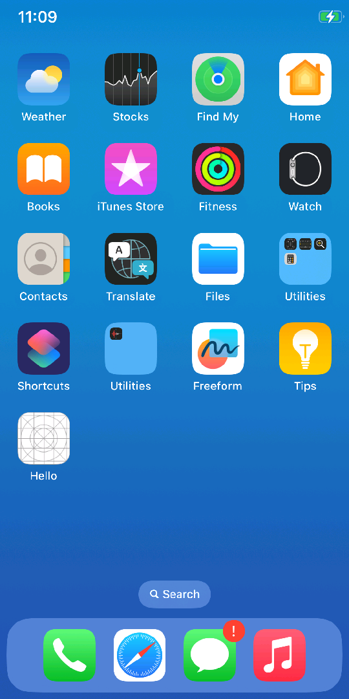
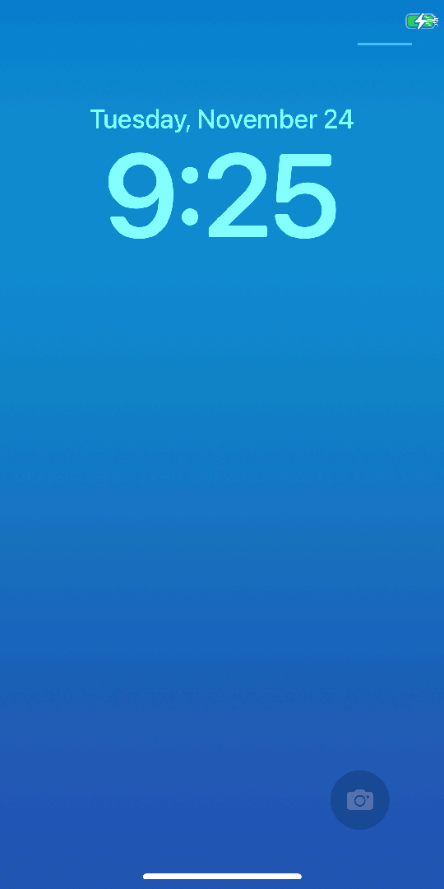
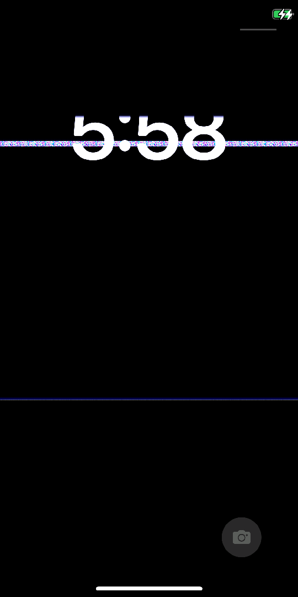
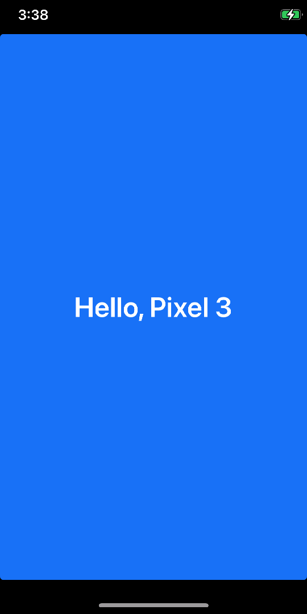

# pixel3-ios

Groundwork for porting [ios-sweet](https://github.com/dipa-studio/ios-sweet)
(Apple's XNU + the iOS 16 userland on a Redmi Note 10 Pro) to the
**Google Pixel 3 (blueline, Snapdragon 845)**.

## Step 1: the probe (`p1-probe/`)

A bare-metal program the Pixel 3 bootloader runs like a Linux kernel. It
touches no storage. One boot reports:

1. Whether the bootloader runs our image and the framebuffer is at `0x9d400000`.
2. Whether colours are `a8r8g8b8` (bars read RED, GREEN, BLUE).
3. **Whether the command-mode panel refreshes by itself**: a yellow bar
   sweeps along the bottom and a `t=Ns` counter runs for 30 s.
4. CPU ID, 16K page support, PSCI version, image and DTB load addresses.
5. The memory map and reserved carve-outs, to place XNU.

It reboots into fastboot 90 s later.

### Run it

Fastboot (power off, hold Power + Volume Down), USB connected:

```sh
fastboot boot p1-probe/out/probe.img
```

`fastboot boot` loads into RAM for one boot; nothing is flashed. The kernel
must be gzip-compressed: an uncompressed Image is rejected with "Error
verifying the received boot.img: Unsupported". If the reboot lands in
LineageOS, `adb reboot bootloader`.

### Reading the result

| You see | Meaning |
| --- | --- |
| Probe screen, bar sweeps, counter climbs | Display path works like on the Redmi. Best case. |
| Probe screen appears but frozen (bar/counter stuck) | Panel needs a per-frame refresh kick (MDP command-mode trigger); needs a small display driver. |
| Fastboot screen stays, phone seems hung | Display doesn't show our writes, or early crash. Hold Power + Vol Down ~10 s. |
| Fastboot rejects the image | Header/DTB format: try v2, or rebuild with the stock `boot.img` (below). |
| Blue "EXCEPTION" screen | Photo it; ESR/ELR/FAR give the fault. |

### Build

```sh
cd p1-probe
./build.sh                      # uses the mainline DTB in ../dtb/
./build.sh /path/to/boot.img    # or reuse a stock (e.g. LineageOS) boot.img's DTBs and addresses
```

Needs LLVM (`clang`, `ld.lld`, `llvm-objcopy`, `llvm-nm`, `llvm-readelf`)
and `python3`. macOS: `brew install llvm lld` (`build.sh` takes tools missing
from `$LLVM` from `PATH`), then
`PATH=$(brew --prefix lld)/bin:$PATH LLVM=$(brew --prefix llvm)/bin ./build.sh`.

QEMU check: `EXTRA_CFLAGS=-DQEMU ./build.sh`, run `out/Image` with
`qemu-system-aarch64 -machine virt,gic-version=3 -cpu cortex-a55 -m 4G -kernel out/Image`,
grab the screen with `pmemsave 0x9d400000 9331200 fb.raw` in the monitor.

`tools/bootimg.py info boot.img` prints a boot image's header, load addresses and DTBs.

### Result of the first run (2026-10-20, LineageOS bootloader, mainline DTB)

All works, including refresh: the bootloader leaves the command-mode panel
refreshing from `0x9d400000`, so ios-sweet's copy-to-framebuffer display
path works unchanged.

| Item | Value |
| --- | --- |
| CPU | MIDR `0x517f803c` (Kryo 385 Silver), boot MPIDR `0x81000000` (core number in Aff1, MT set) |
| Pages / PA | 16K granule supported, PARange 40-bit, GIC sysreg interface |
| Firmware | PSCI 1.1, SMCCC 1.2, CNTFRQ 19.2 MHz, EL1 with MMU off |
| Loaded at | image `0x80080000`, DTB `0x84500000`, initrd `0x84700000` |
| RAM | one range `0x80000000`, size `0xfe0a0000` (4064 MiB) |
| Carve-outs | all below `0x9f800000` except rmtfs `0xf2700000`+`0x202000` |
| XNU candidate | `0xf2a00000`..`0x17e0a0000` (~2.2 GiB contiguous); fallback `0x9f800000`..`0xf2700000` (~1.3 GiB) |

### Second run: LineageOS DTB (2026-10-20)

`./build.sh boot.img` from `lineage-22.2-20261005-nightly-blueline`
(sha256 `15b794c4…69b6f5ba`, in gitignored `stock/`): header v2, lz4 kernel,
two SoC-only DTBs (SDM845 v2, v2.1); the bootloader picked one and applied
the Pixel overlay from `dtbo`: MODEL `Google Inc. MSM sdm845 B1 DVT1.1`,
COMPAT `google,b1c1-sdm845`, DTB 487342 bytes. CPU, firmware, load
addresses, RAM and display match the mainline run.

Downstream carve-outs (27, from the screen photo; names cut to 9 chars):

| Base | Size | Name | | Base | Size | Name |
| --- | --- | --- | --- | --- | --- | --- |
| `0x85700000` | `0x600000` | hyp | | `0x97800000` | `0x500000` | video |
| `0x85e00000` | `0x100000` | xbl | | `0x97d00000` | `0x800000` | cdsp |
| `0x85fc0000` | `0x2f40000` | removed | | `0x98500000` | `0x200000` | mba |
| `0x8ab00000` | `0x1400000` | qseecom | | `0x98700000` | `0x1400000` | slpi |
| `0x8bf00000` | `0x500000` | camera | | `0x99b00000` | `0x100000` | pil_spss |
| `0x8c400000` | `0x10000` | ips_fw | | `0x9d400000` | `0x2400000` | cont_splash |
| `0x8c410000` | `0x5000` | ipa_gsi | | `0xa1800000` | `0x10000` | debug_info |
| `0x8c415000` | `0x2000` | gpu | | `0xa1810000` | `0x200000` | ramoops |
| `0x8c500000` | `0x1a00000` | adsp | | `0xa1a10000` | `0x200000` | alt_ramoops |
| `0x8df00000` | `0x100000` | wlan_fw | | `0xa1c10000` | `0x1000` | ramoops_meta |
| `0x8e000000` | `0x9800000` | modem | | | | |

Dynamic (size only, placed by Linux; XNU doesn't need them): adsp
`0x1000000`, qseecom_ta `0x1000000`, secure_sp `0x800000`, secure_display
`0x900000`, mem_dump `0x2400000`, linux,cma `0x2000000`.

Versus mainline: the overlay grows modem to `0x9800000`, moving
video..pil_spss up by `0x2000000` (node names like `video_region@0x95800000`
are stale), and adds ramoops/debug_info at `0xa1800000`..`0xa1c11000`. No
fixed rmtfs downstream; mainline's `0xf2700000` is a Linux-side choice.

**XNU memory range:** all fixed carve-outs in both trees end by
`0xa1c11000` (except mainline rmtfs). Step 4 uses `0xf2a00000`..`0x17e0a0000`
(~2.2 GiB), free in both. `0xa2000000`..`0xf2700000` (~1.3 GiB) is also free
if more or sub-4 GiB DMA RAM is needed; rmtfs matters only once the modem runs.

## Step 2: XNU to its framebuffer console (`p2-shim/`, `tools/`, `xnu/`)

```
ABL (unlocked, LineageOS bootloader)
  -> fastboot boot p2-shim/out/shim.img     RAM only, nothing flashed
     -> shim: checks the live DTB, copies the payload linked into its own image
        -> XNU (ios-sweet's SWEET kernel + our blueline patch), ADT, boot_args
```

| Piece | What |
| --- | --- |
| `tools/mkadt.py` | Apple Device Tree for blueline: RAM `0xf4000000`+`0x8a000000`, GIC, timer INTID 19, `sweet-fbcon` at `0x9d400000` 1080×2160, one CPU. No storage node, so the kernel cannot touch UFS. `--qemu` swaps in QEMU virt's GIC/timer |
| `tools/mkpayload.py` | Kernel Mach-O + ADT + boot-args into one payload; applies the kernel's chained fixups (nothing else would) |
| `tools/adt.py` | ADT serializer/parser, `adt.py dump X.adt` |
| `p2-shim/` | Loader. Payload is linked into the shim Image, which ABL unpacks at `0x80080000` with ~68 MiB free below the DTB (the ramdisk's 16 MiB gap below `hyp` at `0x85700000` is irrelevant). Refuses kernel RAM outside `/memory` or overlapping fixed `/reserved-memory`, the framebuffer, itself or the DTB. Then 3 s pause (for a photo), copy, jump with MMU off, `x0` = boot_args |
| `xnu/patches/` | Our XNU patches, applied after ios-sweet's. `0100-blueline-early-framebuffer.patch`: early debug console on the blueline framebuffer (same 32 MiB block at `0x9c000000` as sweet's, so mappings stay) |
| `.github/workflows/xnu.yml` | Kernel build on GitHub macOS 14 runners: blacktop/darwin-xnu-build, xnu-8796.141.3, ios-sweet patches 0001-0027 at a pinned commit, then ours. Fails if any patch is skipped |
| `common/` | Entry code, framebuffer console, FDT walker, PSCI/reboot, shared build steps |

Only ios-sweet patches up to 0027 (RAM-disk root) are used. 0028+ add the
UFS root and writes to `userdata` (LineageOS's data on this phone); they come
in only as a deliberate later step.

### Build and run

```sh
gh workflow run xnu.yml                          # or push a change under xnu/
gh run download RUN_ID -n xnu-kernel -D xnu/out
python3 tools/mkadt.py p2-shim/out/blueline.adt
python3 tools/mkpayload.py xnu/out/kernel.development.sweet p2-shim/out/blueline.adt \
    p2-shim/out/payload.bin --cmdline 'debug=0xc serial=3 cpus=1 keepsyms=1 -enable_kprintf_spam'
p2-shim/build.sh p2-shim/out/payload.bin stock/boot.img
fastboot boot p2-shim/out/shim.img
```

QEMU check of the loader with a stand-in kernel (`p2-shim/test/testkernel.c`,
arm64 Mach-O with chained fixups): `p2-shim/test/run-qemu.sh` must print
`screen: GREEN (pass)`. 2026-10-20: passes, and fails with a wrong cmdline.

### First XNU boot on the phone (2026-10-21)

CI run 39504429541 (ios-sweet 0001-0027 + our 0100), payload 16.3 MB,
`debug=0xc serial=3 cpus=1 keepsyms=1 -enable_kprintf_spam`, shim built with
the LineageOS DTBs.

**XNU runs on the Pixel 3 and prints to the framebuffer.** Photo shows VM
bootstrap, zone_init, OSLog/firehose, scheduler, "iBoot version:
pixel3-shim" (our ADT), SWEET PRNG, pthread, AMFI, "SWEET: platform expert
registered", `ml_processor_register`, `cpu_start() cpu: 0`, BSD banner, MAC
framework, then `SWEET CPU: boot CPU 0 registered, SGI1 verified,
initialization complete` (GIC delivers a self-IPI). Early marker band drawn.

It continues as in QEMU: ktriage, SWEET HFS, mcache/mbinit (64 MB pool),
DLIL SUM16 and Skywalk self-tests (PASSED), lo0/gif0/stf0, `!BSD`, then

    Waiting on <dict ...><key>IOProviderClass</key><string>IOMedia</string>
    <key>Content</key><string>Apple_HFS</string></dict>

**Step 2 done: XNU boots to "waiting for root device".** Scheduler, timer
interrupts and GIC work; display needs only copies into ABL's framebuffer.
No root disk yet, so this is the expected end. Power + Volume Down returns
to fastboot.

## Step 3: iOS root on userdata (in progress)

Approved 2026-10-21: erase LineageOS's `userdata` for the iOS root; every
flash is still confirmed separately. Nothing else is touched.

| What | Value |
| --- | --- |
| `userdata` | `sda21` = UFS LUN 0, `0xCE4FFB000` bytes (51.6 GiB), fastboot type `raw` |
| Kernel | ios-sweet 0001-0059 + ours (CI run 39506022755): UFS root driver (writes only with `ufsrw=1`), AMFI/sandbox/keystore/watchdog stand-ins, IOSurface + framebuffer services, HID services, iPhone identity. 0060+ drive sweet-only keys/touch/regulators/USB and stay out |
| ADT | `mkadt.py --ufs` adds the UFS host; `--iphone DeviceTree.d22ap.im4p` the iPhone X identity and `/product` |

**Read-only UFS test (2026-10-21), passed.** `rd=ufsroot0` without `ufsrw`:
the kernel took over the UFS host ABL left running, found `userdata` in LUN
0's GPT, attached `ufsroot0`, read the HFS+ header: "unknown Volume
Signature : 394f" (LineageOS's encrypted data), retried the mount in a loop.

**First flash and boot (2026-10-21).** `fastboot flash userdata` (sparse,
45 x 256 MiB; ABL max-download-size `0x10000000`, so no `-S 512M`), 334 s.
Boot `--ufs --iphone`, `rd=ufsroot0 ufsrw=1 rootrw=1
launchd_unsecure_cache=1 ignition_level=1 unentitled_ios_sim_launch=1 ...`:
UFS rw, persistent log at the last 4100 KiB, **HFS+ root mounted**,
`/sbin/launchd` ran, libignition started, then `cs_invalid_page` on a
launchd page, pid 1 SIGSEGV -> "initproc failed to start". Cause:
`img2simg.py` wrote zero blocks as DONT_CARE, so zero blocks in files kept
old bytes. Fixed (FILL chunks of 0).

**Second flash and boot (2026-10-21 00:50): iOS userland runs.** Reflash
445 s; ABL then hung receiving the boot image (as on sweet after big
flashes), cleared with Power + Volume Down. Log (`tools/phone.sh log`, 2212
lines): ~100 daemons stay up; `bluetoothd` and `fairplayd.H2` crash-loop (no hardware / no SEP),
`driverkitd` killed once. backboardd opens AppleCLCD 1080x2160, creates
IOSurfaces, presents 5 frames (the logo), then backboardd and SpringBoard
block. No data migration (`migrationpluginwrapper` absent). Kernel text
draws over the panel (console not muted yet).

**SMP: all eight cores (2026-10-21).** ios-sweet 0001-0059 + 0065 + our 0101
(CI 39511860472), ADT `--cpus 8`, `cpus=8`: CPU_ON rc=0 and "came alive;
SGI1 OK" for MPIDR 0x100..0x700, then `SWEET CPU: 8/8 CPUs initialized,
SGI1 verified`. Silver and Gold form one homogeneous cluster (no Gold
preference).

**8 cores are slow (CI 39512538196, `cpus=8`).** Process hand-offs stall
for minutes (`seputil`, 0.16 s on one core, took 3 min; the 1 s log thread
flushed 8 times in ~7 min). Not hardware (probe): CNTPCT-CNTVCT is 0-1 tick
on all cores, and with the GIC set up as XNU does a 10 ms virtual timer
wakes every core from WFI with INTID 19 pending.

**Kernel 0103 (per-CPU stats every 5 s) boots fast to the Apple logo** on 8
cores, console muted (1125x2436 frames, so 0061 works); the stats thread
seems to mask lost wakeups. After ~9 min all cores had 25k-107k timer
interrupts and 10k-28k IPIs. Symbolicated with the shared cache (`ipsw dyld
a2s CACHE ADDR --slide 0x4705c000`): SpringBoard's main thread waits in
`_LSContextInitCommon` (LaunchServices lock) from Control Center's
`CCSModuleRepository`; lsd builds its database on first boot.

**8 cores, migration boot (2026-10-21 02:20): stuck again** at `exec
seputil`, log ends t=223 s. Gold cores (cpu4-7) took no IPI or timer
interrupt after start-up (counts 1/1). Intermittent (0103 run had
thousands). Back to `cpus=1`; SMP is a separate track.

Root image tools (ours; which iOS details matter is from ios-sweet's notes):

| Tool | What |
| --- | --- |
| `tools/mkiosroot.sh` | macOS, `sudo`: mounts the IPSW's OS, SystemOS and AppOS APFS images (owners on), makes a raw 16 GiB case-sensitive journaled HFS+ image (`newfs_hfs`), copies decompressed with `rsync -aH`, links shared cache and cryptex files, creates logd stores and system keybag, runs the tweaks |
| `tools/iosroot-tweaks.py` | No crash panics, no CommCenter, containers, migration done, Setup skipped, audio/media crash paths off, activation data ark |
| `tools/img2simg.py` | Raw image -> Android sparse image for `fastboot flash userdata` (zero blocks as FILL 0) |
| `tools/simgdiff.py` | Sparse image of only blocks that differ from the flashed image: a change flashes in seconds |
| `tools/rootimg.sh` | `sudo` mount/umount of a raw root image on the Mac (owners kept) |
| `tools/phone.sh` | From LineageOS recovery (adb root): `log` pulls the persistent kernel log; `sync BASE.img` copies the 4 MiB pieces that differ on the phone into BASE so it is a valid diff base again |
| `tools/phonelog.py` | Decodes the log ring ("SWEETLOG" header + 4 MiB ring at the end of userdata) |

Changing the root without a full reflash (`rootrw=1` boots write to the
volume, so sync the base from the phone first):

```sh
fastboot reboot recovery                       # then Advanced -> Enable ADB
tools/phone.sh log                             # -> work/phone-log.txt
tools/phone.sh sync work/ios-root.img
cp -c work/ios-root.img work/ios-root-new.img
sudo tools/rootimg.sh mount work/ios-root-new.img   # edit under work/root
sudo tools/rootimg.sh umount
tools/simgdiff.py work/ios-root.img work/ios-root-new.img work/diff.simg
adb reboot bootloader && fastboot flash userdata work/diff.simg
mv work/ios-root-new.img work/ios-root.img
```

## Step 4: input (in progress)

`p3-input/` (probe, read-only on the PMIC), 2026-10-21:

| What | Result |
| --- | --- |
| SPMI arbiter | v5 (`0x50000000`), 512 APIDs; PON APID `0xac`, GPIO 6 APID `0xbe` |
| Power | PON INT_RT_STS (`0x810`) bit 0: works |
| Volume down | `0x810` bit 1 (RESIN): works |
| Volume up | GPIO 6: input, enabled (`mode 0x00`, `en 0x80`, subtype `0x10`), but STATUS1 stays `0x80` and INT_RT_STS `0x00` when pressed; left out for now (solved below) |
| Touch | `st_fts@49`, `st,fts`, on `i2c@888000` (`qcom,i2c-geni`); IRQ GPIO 125, reset GPIO 99, switch GPIO 136, `vdd`/`avdd` supplies, max 1079x2159. ST FTS protocol as in ios-raphael's 0086 (fts_521) |

`0104-blueline-keys.patch`: power + volume down polled every 20 ms into the HID services (`bluekeys=0` off).

**LaunchServices never seeded.** Probe: 100 WFE take 82 us (Silver) / ~412 us (Gold), so the event stream is not the 8-core stall. lsd blocks in `__LAUNCH_SERVICES_CLIENTS_ARE_WAITING_FOR_THE_DATABASE_TO_FINISH_SEEDING__` and `-[_LSInstallProgressService restoreInactiveInstalls]` because our tweaks skipped first-boot data migration (sweet ran it once). Fix: `phone.sh sync` (142/4096 pieces changed), `tools/migration-reset.py` on a clone (markers removed, `/private/var/datamigrator/migrate` sentinel), 404 KB diff flashed in 0.5 s; `iosroot-tweaks.py` no longer skips migration.

**Touch over GENI I2C (failed).** `p3-input` enabled QUP wrapper 0 / SE2 (`0x888000`; clocks per `gcc-sdm845.c`: vote `0x5200c` bits 6/7/12, SE2 RCG `0x17294` on XO; SDA/SCL GPIO 27/28 = `qup2`; s2 CBCR `0x4220`, wrapper `0x1700c`/`0x17010`), firmware I2C (`0x300`), `GENI_CGC_CTRL`/`OUTPUT_CTRL`/`FORCE_DEFAULT`/`M_IRQ_EN` set, reset GPIO 99 high, to read the chip ID (`0xFA 20 00 00 00`) and FIFO events (`0x86`). No command ever starts (GENI status and M_IRQ_STATUS stay 0). Kernel `0105-blueline-touch.patch` is the polled version (`bluetouch=1`).

**SMP hardware fully checked (probe):** SGI 1 from core 0 with XNU's encoding (`ICC_SGI1R` Aff1 = core, TargetList bit 0) reaches every core in 4-7 us. The 8-core hangs are in XNU's SMP path, not hardware; iOS stays on `cpus=1` meanwhile.

**Data migration runs (1 core, 0103-0105).** A first boot hung after `DONE MKB_INIT` when launchd exec'd `usermanagerd` (no crash); the next passed and showed the migration bar: ~98% in ~30 min, then a crawl. After ~1 h 50 min: `migrationpluginwrapper` ran 3x, backboardd presented **193,000 frames** (~60 Hz, a 10 MB CPU copy each on the only core), 2x `hfs_clonefile: cluster_write failed - 34`. **Keys work in iOS** (`SWEET HID: key 0x30/0xea ... (1 clients)`). Rebooted with `sweetfb_hz=10` (0056's panel-copy throttle).

### Touch works (probe, 2026-10-22)

ST FTM5 (chip id `36 39`) at I2C 0x49. Four findings:

1. **GPI DMA crashes the SoC.** SE2's FIFO interface is disabled (`SE_GENI_IF_DISABLE_RO` 0x064 = 1), so Linux uses GPI DMA. GPII 1 and both channels start, the SMMU takes a stream entry for SID 0x16 (bypass bank, which SDM845 turns into "fault", or the firmware's UFS bank), but the first descriptor fetch freezes the SoC within 1 ms. Likely no QUP-to-DDR interconnect vote. Parked.
2. **Bit-banged I2C works** (as HackiOS hand-drives its panel SPI): GPIO 27/28 open-drain, ~100 kHz. The chip ACKs only with GPIO 136 (`st,switch_gpio`) high: bus to the AP, not the SLPI sensor hub.
3. **Start-up as Google's `stm/fts.c`**: system reset (`FA 20 00 00 24 80`), "controller ready", interrupt enable at 0x20000029 (`... 29 41`; not 0x2C), `A0 00 FF` (scan mode active).
4. **avdd was off.** `avdd-supply` = PM8998 LDO19 (3.3 V), owned by the AOP (SPMI owner 4), off after ABL; the chip scanned but saw no finger. The probe votes via RPMh as Linux does: `ldoa19` from cmd-db (0x41a00, cmd-db at 0x85fe0000), 3300 mV, HPM, enable, in active TCS 0 of the apps RSC (DRV 2, 0x179e0d00).

Touches then gave motion events (`23 01 ...`, x=508 y=1600). `0113-blueline-touch-bitbang.patch` does this in the kernel, default on (`bluetouch=0` off); reads the FIFO when IRQ GPIO 125 is low and every 100 ms.

### Touch in iOS (2026-10-22 23:07)

`0113` + `0114` (cmd-db mapped at a fixed 128 KiB: the locator's second word is not a size, so the RPMh vote never went out), `cpus=4 wfi=0` (`shim-touch4b.img`): **touch works in iOS**. The 1125x2436 canvas was cropped to 1080x2160 (138 rows lost top and bottom). `0115-blueline-display-fit.patch` scales to panel height (nearest neighbour, 997x2160, 41-column bars), touch mapped the same; `bluefb_fit=0` crops. `cpus=8` with real WFI stalled at the "SWEET SMP" lines in 3 of 6 boots.

### 8 cores, SMP stall, panel rate (2026-10-22, late)

`0116-blueline-smp-diag.patch`: per-CPU IPIs sent, `cpu_signal`, scheduler state/priority/thread, GICR SGI pending/enable, WAKER. In a stall (`work/log-diag8.txt`) Gold IPIs and timers work; boot stopped after `exec init_featureflags` (earlier `exec seputil`) with one priority-31 user thread spinning on cpu0, only on 8 cores. `sweetsample=init_featureflags,seputil,launchd` captures its user stack. Good 8-core boots run Gold at 2649 MHz, Silver at 1766 MHz. Panel copy rate 30 Hz on 8 cores (`shim-hz30.img`).

GPU plan: follow HackiOS's staged Adreno 642L bring-up (`redwood_adreno.c`) for the A630; Mesa freedreno behind an EAGL bridge in backboardd.

### SMP stall found: stale table-walk entries (2026-10-23)

The sampler caught `seputil` in dyld (`lsl::PersistentAllocator` constructor from `start`) refaulting forever on one store to fresh memory. `0117-blueline-fault-loop.patch`: after 10,000 consecutive faults on one address, `TLBI VAAE1IS` that VA. In `work/log-flt8.txt` it fired 11 times, each ESR `0x92000047` (level-3 translation fault, write), PAR `0x80f` (the hardware walk faults though the page is mapped), cleared by the invalidate. Cause: stale table-walk cache entries. A proper fix would invalidate non-leaf entries when XNU frees page tables. `0118-blueline-touch-edge.patch`: edge-tip flag on touches starting at an edge (as ios-sweet 0071), for home and app-switcher gestures.

**Booting without fastboot:** `shim-edge8.img` flashed to `boot_a`, slot A active (old `boot_a` in `backup/boot/boot_a.img`). Slot B keeps LineageOS + recovery (`fastboot --set-active=b`); back with `--set-active=a`.

### Bold Text hangs the respring (2026-10-23)

Bold Text makes SpringBoard hang on respring and every later boot. Fix from recovery: `tools/phone.sh sync`, `tools/prefs-fix.sh com.apple.Accessibility EnhancedTextLegibilityEnabled false` (sets/removes one key under `/private/var/mobile/Library/Preferences`, builds `work/diff.simg`), flash the 0.4 MiB diff. `fastboot reboot recovery` is unsupported: `--set-active=b`, then Recovery mode in the bootloader menu.

### ios-flame (Pixel 4): the closest port, and the roadmap from here (2026-10-23)

[ios-flame](https://github.com/NWylynko/ios-flame) (MIT, dipa-studio): same base (ios-sweet's XNU 8796 patches, iPhone X 16.7.16, Google ABL `fastboot boot`, root on `userdata`); SM8150 / Adreno 640 (A6xx); Wi-Fi is a **WCN3990, our chip**. To take, in order:
1. **USB Ethernet** (0088-0091): live log, UDP command server, TCP file server; USB DMA "through the apps SMMU the way ABL does it (own context bank, translation off)".
2. **RTC** (0099, PM8150; ours PM8998, same SPMI RTC type).
3. Generic fixes: 0084 early framebuffer Device-GRE; 0098 panic logs into the ring; 0100 clonefile fallback; 0103, 0114 AMFI answers; 0104 planar IOSurfaces (blank Safari pages); 0121 vsync period for CoreAnimation.
4. **Wi-Fi** (0123/0124 plus `wland`).
5. **GPU / Metal** (0095-0122: A640 core, present, Turnip + metal2vulkan).

From ios-sailfish: `0121-blueline-touch-irq.patch` (their GIC SPI support 0181; touch on the TLMM summary interrupt, INTID 240, GPIO 125 level low; moves coalesced to 60/s per 0182; `bluetouchirq=0` polls). Also `tools/remigrate.sh` (removable system apps, wallpapers/posters), `mobileassetd` back, `0119`/`0120` static AppleSmartBattery (as ios-raphael 0101).

### Other ports worth following

- **ios-sailfish** (Pixel 1, Snapdragon 821; owner known to us): Adreno 530 via own kernel GPU driver (power, clocks, SMMU, CP microcode, zap, BOs + submission) and Mesa freedreno (GLES 3.1) in backboardd as `sweetgl.dylib` behind an EAGL shim (no Metal); MDP double-buffered flips, 15-35 fps. A6xx additionally needs the GMU (firmware, HFI, RPMh); Linux's `drm/msm/adreno/a6xx_gmu.c` is the map.
- From sailfish (credited to ios-topaz): IOKit never quiesces on iOS (no `kernelmanagerd` to drop the IOKit-daemon busy hold), and QuartzCore polls `IOAcceleratorES` 300x/100 ms per process. `0107-iokit-quiet-ioacceleratores.patch` removes the hold and registers an empty `IOAcceleratorES` (`sweetaccel=0` off).
- **HackiOS** ([hackios-xnu-kernel](https://github.com/oosexgang/hackios-xnu-kernel), [hackios-xnu-userland](https://github.com/oosexgang/hackios-xnu-userland); POCO X5 Pro, SM7325): lock screen in ~20 s on 8 cores, Adreno via Mesa, Wi-Fi, sound, camera. Different base (xnu-8796.121.2 built on Linux, own platform expert and drivers, `docs/PORTING.md` starting with a UEFI port, EFI loader from Mu-Silicium UEFI, which lacks the Pixel 3; iOS 16.5). Taken: `0112-blueline-idle-no-setway-flush.patch`: XNU's `cpu_idle()` on non-Apple cores cleans the whole D-cache by set/way on every WFI, unsafe with other cores running and trapping to Qualcomm's hypervisor (likely cause of the `wfi=0` workaround and 8-core stalls). Candidates: small-core scheduler pairing, memorystatus thresholds fix, their keystore.

### 8 cores + keychain fix (2026-10-22)

`shim-aks8.img` (`cpus=8 wfi=0`, 0111): all 8 cores active (cores 5-7 ~1 M IPIs each), `aks_wrap_key` returns 0. Stopped at 68,000 frames; bluetoothd (106) and fairplayd (70) kept restarting.

### HackiOS userland changes (flashed 2026-10-22)

`tools/iosroot-tweaks.py` now matches HackiOS: migration done for 20H392 (`LastSystemVersion` plus `DMLastMigrationResults = {success, buildVersion}` in `com.apple.migration`; our earlier skip lacked the second key), datamigrator sentinel removed, their launchd deny list, `FBLaunchWatchdogScale = 20`, `ForceNoBuddy`, battery percentage. Cycle: `tools/phone.sh sync work/ios-root.img`, `tools/tweak-diff.sh`, flash `work/diff.simg`. 2.6 MiB diff, 52 jobs removed (all Bluetooth, Wi-Fi daemons, routined, syncdefaultsd, homed, keybagd, watchdogd, ...). No job label contains "datamigrator"; the done-records alone skip migration. fairplayd not on the list.

**Lock screen (2026-10-22 22:01).** Second boot of `shim-idle8.img` (0112, `cpus=8`, real WFI) on this root: lock screen, no migration bar. Needed 0111, 0112 and HackiOS's records and deny list. The first boot hit an "SMP timing" error (log overwritten): 8 cores not fully reliable.

### Migration stuck at the end of the bar: keychain (2026-10-22)

Overnight 4-core run with 0107 stopped at ~193,000 swaps again. routined, mobiletimerd, liveactivitiesd, fitnesscoachingd, remotepairingdeviced, calaccessd (~49 launches each), healthd and tccd (~25) restarted without crashing; `securityd` called AppleKeyStore selector 10 (`aks_wrap_key`) 20 times, refused (`0xe00002c7`): no keychain item can be written. `0111-aks-wrap-unwrap.patch`: wrap = 8-byte marker + key (AES key wrap's overhead), unwrap checks and strips it (no secrecy). With `wfi=0` and no charger driver the battery ran flat overnight.

### USB networking and live log (not working yet; see "USB on the second phone")

ios-sweet's USB driver (0072-0077, 0081: DWC3 device mode, CDC-ECM, console as UDP) uses addresses shared with sweet: DWC3 `0xa600000`, qscratch `0xa6f8800`, QUSB2 v2 PHY `0x88e2000` (`qcom,sdm845-qusb2-phy`), GCC `usb30_prim_gdsc` `0xf004`. CI stages `sweet_usb.c` via `xnu/patches/0108-stage-sweet-usb.sh` plus `0108-blueline-usb-hooks.patch`. `sweetusb=1` (default) reports state, `sweetusb=2` starts the device; `tools/usblog.sh` (host MAC `02:00:5e:77:ee:01`, `192.168.7.1/24`, UDP 5140) shows the console.

First run (`sweetusb=2`): `ue0 192.168.7.2/24` up, soft reset fine, then `ep0 cmd 0x1 timeout` (SETEPCONFIG). ABL ran fastboot at **SuperSpeed** (`DSTS` speed 4; sweet's ABL used USB 2), and the clock table had SM7150 offsets (SDM845: master `0xf00c`, sleep `0xf010`, mock UTMI `0xf014`, aux `0xf04c`). `0110-blueline-usb-superspeed-phy.patch`: USB3 PHY may suspend (`GUSB3PIPECTL` bit 17; `blueusb3susp=0` skips), `blueusbreset=0`, 20 ms command timeout, SDM845 diagnostics. Also: Silver already at top level (17 = 1766 MHz, 0106); Gold's cpufreq controller "not enabled".

### Volume up (2026-10-22)

GPIO 6 STATUS1 bit 0 follows the key (`0x81` released, `0x80` pressed); pull-up (`DIG_PULL_CTL` `0xc542` = 0) already set. `0109-blueline-volume-up.patch` reads it as key 1 (`bluevolup=0` skips).

### Wi-Fi

See the 2026-11-19 section below. Full plan (stages 2-5, about 45-100 h to Settings) is outside the repo as `wifi-plan.md`.

### A second phone from scratch, kernel built locally (2026-11-18)

Second Pixel 3 (stock `SP1A.210812.016.C1`, unlocked) from the README on an M1 Mac, macOS 26.6, no CI (GitHub retired `macos-14`; newer images only have Xcode 16+).

- **LineageOS 22.2** `20261116` (sha256 checked): `fastboot flash dtbo_b` / `boot_b`, Recovery mode from the bootloader menu, Format data, `adb sideload` twice (both slots). `adb` stopping at ~47% with `failed to read command` is normal for A/B.
- **Backup**: `tools/backup-phone.sh`, 62 MB, off git.
- **Kernel on the Mac**: Xcode 15.4 beside Xcode 27 (`xcodes`), via `DEVELOPER_DIR`, not `xcode-select` (harmless DVTDownloads warnings). KDK: `pkgutil --expand-full` of `KernelDebugKit.pkg`, `KDKROOT=<Payload dir>` instead of `sudo installer`. All 95 patches applied. Patch loop needs bash (zsh rejects `[ "$num" \> ... ]`).
- **Shim**: needs Homebrew's keg-only LLVM on PATH (`/opt/homebrew/opt/llvm/bin`, `.../lld/bin`), else `llvm-readelf` / `llvm-objcopy` "command not found" and no `shim.img`.
- **Root**: `mkiosroot.sh` on iPhone X 16.7.16, sparse 11 GB, flashed in 399 s; ABL hung on the next command (Power + Volume Down).

**A fresh root stops at the Apple logo** (4-7 frames, then nothing; no DataMigrator). The migration-done records mean a never-migrated root never seeds LaunchServices. Fix: `tools/phone.sh sync`, `tools/remigrate.sh` (needs the IPSW's original `System/Library/xpc/launchd.plist` in `work/orig`), 4.4 MB diff.

**Lock screen on the second phone (2026-11-18 23:26).** `cpus=8` (real WFI), `sweetfb_hz=30`, `sweetfb_noconsole=1`: migration bar 20% at ~8 min, 80% at ~15 min, lock screen at ~18 min. No SMP stall in either 8-core boot.

**Software rendering** is laggy (CPU compositing, 30 Hz copy); materials draw flat white, widgets stuck at "Waiting...", some Control Center glyphs garbled.

**Screen off on lock (0123, draft).** ios-sweet's 0079 rebased onto 0115: on framebuffer power-off the vsync timer stops copying and blacks panel memory (AMOLED black is off). Works. 0079's fade (halving over 7 vsyncs, ~9 MB CPU rewrite each) was slow; now one dimmed pass then black. DCS sleep (`bluefb_dcs=2`) not tried.

**USB on the second phone (0122 + 0124 draft, `sweetusb=2`).** Nothing enumerates. Clocks and GDSC on, DWC3 GSNPSID 0x5533300a, soft reset 1 ms, then DEPSTARTCFG (`ep0 cmd 0x1`) times out after 20 ms, also with PIPE clock on UTMI; DCFG/DSTS `00480800`/`00520000`, QUSB2 PLL_STATUS `0x64`. Ruled out: 0122's SMMU fix, PIPE clock. (Cause found 2026-11-20: QUSB2 PHY left powered down, 0176.)

**GPU stage 1: the GMU answers (0125, 2026-11-19).** `bluegpu=1` probe after Linux's a6xx_gmu.c, gpucc-sdm845.c and Google's crosshatch kernel, cross-checked with ios-flame and HackiOS. A6xx has no chip-id register; proof of life is the GMU always-on counter. ABL leaves `gcc_gpu_cfg_ahb` on and CX/GX collapsed (`0x222001`); cmd-db gfx.lvl `0x30050`, cx.lvl `0x30000`, mx.lvl `0x30010`; CX GDSC on, memnoc_gfx/ddrss_gpu_axi/cx_gmu/cxo running, GMU RCG on XO; counter 19195615 Hz; CM3 in reset (`sysreset 0x1`), init result 0, RPMh power state `0xf`, RSCC TCS0-3 `0x1`. All restored after.

**GPU stage 2a: GMU firmware running (0126).** `bluegpu=3`. linux-firmware `qcom/a630_gmu.bin` (88ea23e7, 32 KiB raw Cortex-M3: 16 KiB ITCM then DTCM) in the ADT (`tools/mkadt.py --gpu-fw`, `/blueline-gpu` `gmu-firmware`; `tools/fetch-gpu-fw.sh`, never committed). The firmware reports init before touching system memory, so no SMMU/HFI yet. Per Linux's a6xx_gmu_rpmh_init/fw_start: RSCC sequencer, GPU PDC (all 0 from ABL), firmware into TCM (9 ms, 0 bad words), start-up registers, CM3 out of reset. **Init result 0xbabeface after 364 us**, fault counters 0; CM3 back in reset, 66 registers restored, iOS boots normally. GMU at 19.2 MHz from XO.

**Hands-off test loop (2026-11-19).**
- LineageOS recovery in `boot_b` repacked with `ro.adb.secure.recovery=0` (`tools/recovery-adb.py`): adb without the Enable ADB tap (recovery's only adb key source is userdata, which holds iOS).
- 0127 `bluereboot=recovery|bootloader` (`bluereboot_after=gpu|springboard|N`): final log flush, PM8998 PON `SOFT_RB_SPARE` (`0x88f`, reason << 1, via the SPMI arbiter shared with the key driver) plus IMEM restart_reason cookie (`0x146bf65c`), PSCI SYSTEM_RESET. ABL honours it (PON `0x10 -> 0x02`).
- `tools/phonetest.sh [--quick] ARGS` (`--quick`: `tools/build-xnu.sh --quick` reapplies only changed patches, ~25 s vs ~25 min): build, shim, RAM boot, wait for recovery, pull and print the log, back to fastboot. First run: 72 s from quick build to log; GMU init 0xbabeface after 366 us.

## Pixel 3 facts used here

| What | Value | Source |
| --- | --- | --- |
| Framebuffer | `0x9d400000`, 1080×2160, a8r8g8b8, stride 4320 | mainline `sdm845-google-blueline.dts`, downstream `cont_splash_region` |
| Panel | LG SW43408, DSC, **command mode** (`dsi_cmd_mode`, TE on GPIO 12) | downstream `dsi-panel-sw43408-dsc-fhd-cmd.dtsi` |
| Reboot reason | IMEM `0x146bf65c` = `0x77665500` → fastboot | downstream `sdm845.dtsi` `restart_reason@65c` |
| PS_HOLD | `0x0c264000` | downstream `sdm845.dtsi` |
| GIC | GICD `0x17a00000`, GICR `0x17a60000` (same as SM7150) | mainline `sdm845.dtsi` |
| UFS | `0x1d84000` (same as SM7150) | mainline `sdm845.dtsi` |
| Image header | `text_offset = 0x80000` (recent Pixel 3 bootloaders need it) | mainline Pixel 3 series cover letter |

`dtb/sdm845-google-blueline.dtb` is built from Linux master (2026-10-19).

## Licensing note (historical)

ios-sweet has no license file, so its code isn't copied here. The probe,
shim, ADT and payload tools are written from scratch (the ADT and boot_args
layouts are Apple's formats; the payload/ADT values follow from the
hardware). The kernel build fetches ios-sweet's XNU patches from their
repository at build time and never stores them here; `xnu/patches/` holds
only our own changes on top. Ask the author before publishing kernels or a
fork that reuses their patches.

## 2026-11-19: GPU on screen, hands-off testing, battery, modem

All on the `display-usb` branch, each tested with `tools/phonetest.sh` (see `docs/TESTING.md`).

### GPU
- **0128/0136/0137, stages 2b-4.** GMU via the Adreno SMMU (EL1 can program it), legacy HFI v1; GX powers on through the GMU; the phone's `a630_sqe.fw` loads; CP_MEM_WRITE lands. PDC gfx address is cmd-db's `gfx.lvl` 0x30050 (Linux's hard-coded 0x30080 is `xo.lvl` here).
- **0144 zap.** TrustZone PAS id 13 loads the zap into `0x8c415000`, then `CP_SET_SECURE_MODE 0`. Before, the GPU ran secure: fences landed, no pixels changed. 0138's CP_BLIT fills now draw.
- **0147 resident GPU (`bluegpu=8`).** GPU presents iOS: 2D-engine bilinear blit 1125x2436 -> 997x2160, 6-7 ms at 257 MHz plus ~2 ms CPU (mostly cache clean).
- **0151.** Fences wake on GPU INTID 332. A forced hang (garbage packet) is caught by RBBM hang detect and recovered (soft reset + CP re-init) in 1.3 ms. `bluegpu_mhz=710` measures 709 MHz, blit 1.4 ms. DCVS (`bluegpu_dcvs=1`) and clean mode 2 untested.
- **Frame rate.** iOS's CPU renderer peaks at ~21 fps; only CoreAnimation on the GPU (6f) changes that.
- **0153 user client (6d).** IOService `BlueGPU`, msm ABI 1.9, selectors = ioctl low byte. 32 MiB pool at pa 0xc0000000 mapped at GPU VA 0x80000000 (imports at 0xc0000000), page tables in WCOMB memory; self-test 32/32. Fixes: a 256 MiB pool doesn't fit the 64 MiB io_map; SMMU needs TCR2.SEP=7, else VA bit 31 selects the disabled TTBR1 (fault at 0x80410000).
- **Mesa (6e).** Mesa 26.3.1 freedreno as `bluegl.dylib` (18 MB), `FD_MESA_DEBUG=noubwc,sysmem`. `gles-triangle`: FD630, ES 3.2, 0 wrong pixels.
- **EAGL shim (6f).** `blueeagl.dylib` in backboardd (`sweetenv=backboardd:DYLD_INSERT_LIBRARIES=/usr/lib/blueeagl.dylib cs_enforcement_disable=1`), EAGL over bluegl. Kill switches: `blueeagl=0`, `/var/mobile/blueeagl.off`, give-up after 3 crashed starts. `eagl-test` passes. First try in backboardd: ~80 GPU frames, black screen, SIGSEGV near 0x18 in our dylibs.
- **6f works (eaglbb2-9).** `CAEnableDeepFramebuffer=NO` (2-plane `'b3a8'` framebuffers can't be rendered: black); bluedrm falls back to USERPTR BOs when the pool is full (Mesa crashed on a NULL BO); `BLUE_GPU_SUBMIT_BO_NOSYNC` cleans those once, not per submit (48 MiB/frame). Frames 30-57 -> 16-31 ms. **0154** fixes blank icons: CoreAnimation's GL renderer asks for surfaces over memory it holds, via selector 6 (refused by sailfish 0206) and creates with `IOSurfaceAddress` (which got fresh zeroed memory); SweetSurface now wraps the caller's range (after HackiOS's MiniIOSurface, APSL; `bluesurf_wrap=0` off).
- **Zero-copy flip (0145, `bluedpu_flip=1`).** DPU scans out backboardd's surface (QSEED3 1125x2436 -> 997x2160). At 710 MHz: 132 flips, 0 copies in 5 s of swiping, 56 fps, latch ~7 ms, no underruns or SMMU faults (the copy had capped the panel at 14-22 fps). **0155**: `bluesnap` samples the flipped surface. **0156**: `blueui=1` = `bluegpu=8 bluegpu_mhz=710 bluedpu_flip=1 cs_enforcement_disable=1 sweetenv=backboardd:DYLD_INSERT_LIBRARIES=/usr/lib/blueeagl.dylib` (explicit args win); ui1: 55–61 fps.

Settings opens by scripted tap, scrolls, opens sub-pages, home gesture returns (`docs/screenshots/`). Scrolling 41–46 fps, each flip waiting ~7.4 ms for the latch.
- **0157**: flip returns after the flush; a GPU submit writing an IOSurface waits for the pending latch (`blue_dpu_flip_settle`) since backboardd alternated two buffers. Scrolling 47–58 fps, no tearing (`bluedpu_flip_sync=1` old wait).
- **0158**: display holds IOSurface uses (`IOSurfaceIsInUse` reads a u64 at +0x18 of the state page). Buffer count unchanged.
- **0159** (root fix): CoreAnimation (`IOMFBDisplay::can_update_`) polls `SwapWait` (IOMFB selector 6, flags bit 31 = poll) and takes another buffer while it answers `0xe00002d5`; ours returned success at once. Now a swap completes when a later swap's flip latches. 3 buffers (0→2→1); latch waits from ~70% of frames to once per run. Home 57–62 fps, Settings scroll 44–54 fps. demo4 (10 min by hand): 58.5 fps average over 752 motion frames, no panics.

Workflow: ABL falls back to slot A after repeated RAM boots, so boot_a now carries the `tools/recovery-adb.py` image too (old boot_a, identical to `stock/boot.img`, backed up outside git).

**0160**: blueeagl's per-frame `glFinish` serialised CPU and GPU. SwapEnd now queues and returns; a kernel flip thread waits for each layer surface's last GPU write (`gpuWriteFence`), then flips; SwapWait pends until latch. The display publishes `HakiosWaitsForGPU` and blueeagl then skips `glFinish`. fthr1: all motion runs 56.5–60.7 fps. `sweetfb_flipthread=0` restores the synchronous path.

**Independent (2026-11-19).** Repo left GitHub's fork network; `master` is the main line (display-usb merged as PR #1); GPU userland in `gpu/`; README credits the original port.

**0161**: `bluetest=1` = phonetest's board args (battery, LMh, watchdog, framebuffer), freeing ~100 of the 607 boot-line bytes for `bluetouchscript`.

**Apps (apps1/apps2).** Settings and Safari 55–62 fps. Under load backboardd adds a 4th buffer ("scanout pool empty"; hardly used). The 32 MiB BO pool fills after a few apps; later BOs come from process memory, fps unchanged.

**Photos** opens black. `sweetsample=MobileSlideShow`: main thread in `MCCopyCheckpointValue` waiting on checkpointd, blocked in a MIG call to fairplayd (restarts forever without SEP). With fairplayd on the DENY list the call fails fast; Photos then throws `NSInternalInconsistencyException: assetsDataSourceManager.dataSource.numberOfSections == 1` (no library, never contacts assetsd). Open. `tools/blueexc` (DYLD-inserted via `sweetenv`, output via `sweetnull`) logs every thrown ObjC exception with stack.

**Hitches.** 100–160 ms frames on first appearance of an app/effect. Mesa disk shader cache (`-Dshader-cache=enabled`, `MESA_SHADER_CACHE_DIR=/var/mobile/Library/Caches/bluegl`): 8 vs 10 frames over 30 ms; compiles weren't the main cause.

**Wrapped images read in place.** `glslow=`: `glBindTexture` 8.7 ms/frame from blueeagl hashing an 11 MB picture (`surface_changed`, until 120 unchanged looks), copied because CoreAnimation's 4500-byte rows broke the 64-byte row rule. A6xx texture PITCH is a plain byte count, so Mesa 0005 lets a one-level linear import keep its pitch; bluegl rounds import size to 4 KiB pages. In-place 12 -> 60 surfaces, copies 112 -> 79.

**What's left of the hitches.** 7–9 frames per app script at 30–100 ms, at launches; no GL call over 4 ms: CoreAnimation CPU work. `glprof`: the submit ioctl is 12–14% of the drawing thread, all cache maintenance of imported surfaces (0162 adds it to the 5 s stats line: 70–100 ms per 5 s). `bluegpu_lazyclean=1`: no measurable change, off. GMEM untried.

**Home screen.** The "Waiting..." icons are two unfinished app installs; removable system apps (`/private/var/staged_system_apps`) and wallpaper are missing. `remigrate.sh` (now also applies the DENY list via `iosroot-tweaks.py --only launchd`), boot `migr1`.

**Why the apps never installed: clonefile.** `migr1` changed nothing. iOS's log via new `tools/phonelog.sh` (7-Zip extracts `/var/db/diagnostics` without sudo; mandiant's unifiedlog_iterator decodes it, since `log show` prints nothing for a log clock starting at 1970): all ~35 SystemAppMigrator installs fail with `MIInstallerErrorDomain Code=107 "Failed to stage ..."` over `Code=4 "Failed to clonefile .../Wallet.app/Icon.png"`. installd stages with `copyfile(COPYFILE_CLONE_FORCE)` (`-[MIFileManager _copyItemAtURL:...alwaysClone:...]`, flags `0x020c800f`), no copy fallback; HFS+ returns ENOTSUP; appstored can't install offline. FairPlay not involved. 0163: `clonefileat` copies in the kernel where `VNOP_CLONEFILE` says ENOTSUP (symlinks re-made). Boot `migr2`.

**Staged apps used up.** `migr2`: a few apps as App Store placeholders, "Did not have a staged app": migration moves apps out of `/private/var/staged_system_apps`, and `migr1`'s failures deleted them. `remigrate.sh` restores the IPSW's 32 apps (305 MB, owner mobile) from `work/OS.dmg` via 7-Zip. Boot `migr3`:
- `MIInstallerErrorDomain Code=13 "Failed to verify code signature of .../Contacts.app : 0xe8008001"` (`+[MICodeSigningVerifier _validateSignatureAndCopyInfoForURL:...]`, libmis), 104 times.
- `Code=59 "Appex bundle ... specifies a value (com.apple.usernotifications.content-extension) for NSExtensionPointIdentifier ... that does not correspond to a known extension point"`, from `Code=142 "Extension cache does not have an entry for ..."` (also `com.apple.intents-service`).

**Signatures: 0164.** Removable system apps are ad-hoc signed (Calculator: `Signature=adhoc`), trusted only via the static trust cache. `tools/bluerun/mistest` (installd's checks on the phone): `SecStaticCodeCheckValidity` returns -66996 ("signature is valid but signer is not trusted") for all ad-hoc code, as on a real iPhone; libmis accepts that with `AllowAdHocSigning`, then with `TrustCacheOnly` asks the **AppleMobileFileIntegrity IOService** (selector 6, cdhash in; 0 = trusted, kIOReturnNotFound = not). We had none: 0xe8008001. 0164 adds it (`BlueAMFI.cpp`) and answers `__mac_syscall("AMFI", 0x5f)` (Security's trust-cache query); both say yes (all root binaries already run as platform binaries). mistest: Calculator 0 (signer type 1). lsd also asks; online-auth-agent asks selector 9 (unsupported). `remigrate.sh` now keeps the test runner's launchd job.

**Extension points: same cause.** installd: `Failed to read extension point cache ... Unable to find AMFI`: ExtensionFoundation reads `/System/Library/xpc/extensions.plist` (138 extension points) only after checking `extensions.plist.sig` via AMFI selector 6. `tools/bluerun/miinstall` (installs via installd like migration): Calculator, Wallet (with extension), Weather, Reminders install on 0164.
- **QuartzCore research.** QuartzCore 16.7.16 falls back to GL when Metal returns nil; its GL function table matches HackiOS's 16.5 exactly.

### Display
- **0140 display probe (`bluedpu`).** ABL leaves CTL_0 in command mode -> INTF_1/DSI0, VIG0/VIG1 fed from the two 540-column halves of `0x9d400000` (stride 4320), DSC, autorefresh on PP_0. Panel 60.9 Hz. FSR 0x400 is the format field, not a fault.
- **`sweetfb_hz=60`** is the default.

### Hands-off testing (no hands on the phone)
- **0146.** `bluesnap=sb+N,...` saves 540x1080 shots below the log ring; `phonetest.sh` pulls PNGs. `bluetouchscript=sb+60:swipe,540,2150,540,700,250` unlocks (sb+30 too early).
- **0148 watchdog** (APSS WDT, default on): a hang bites into recovery.
- **0152 push and run.** `phonetest.sh --push LOCAL:/path` copies into the root before launchd (`bluepush=1`, 3 files in 21 ms); `--run /path,args` runs after SpringBoard, output as `BLUERUN:` lines. Ad-hoc arm64 binaries run as platform binaries. The runner's launchd job came via a pushed `System/Library/xpc/launchd.plist`.
- **`tools/patch-check.sh`** applies a draft patch in a clone of the built tree and compiles it with the build's clang line. `docs/AGENTS.md` briefs drafting agents.
- **Build fix.** A hand-fixed `patch-list.txt` had dropped sailfish 0200-0208 (sweetenv, AMFI dyld policy, IOSurface) from quick builds; `--quick` now keeps them. Full rebuild 3 min.
- **Workflow.** ABL counts each RAM boot as a failed slot-B boot, so `phonetest.sh` runs `fastboot --set-active=b` first; after 60 s without fastboot it asks for a replug. `bluereboot_after` takes only `gpu`, `springboard` or N seconds; `bluereboot_delay=S` adds a delay.

### Other hardware
- **Battery (0130 + 0141).** MAX17201: 99%, 4335 mV, 476 cycles, 2445/2944 mAh. Open: shows charging after unplug (PMI8998 USBIN stays 0x10).
- **0129 RTC.** Correct; the earlier wrong time was the Cupertino time zone.
- **0139 / 0143.** Gold 2649 MHz; TrustZone accepts every LMh call, so hardware throttles on heat.
- **0135 rotation.** Fake accelerometer: both volume buttons, or `bluefakeaccel_cycle`.
- **0150.** Brightness: DCS 0x51 writes work (17-step ramp, 0 failures); backboardd calls IOMFB selectors 50 and 68. Vibrator is a Cirrus CS40L20, not DRV2624: `bluehaptic=2` loads vendor `cs40l20.wmfw`/`.bin` (in the ADT), DSP runs 24 waveforms, `/dev/bluehaptic` takes `click N` and `vibe MS`; buzz not yet felt.
- **0149 modem (Wi-Fi stage 2).** DTB says MBA self-auth, not PAS; firmware read only from `modem_b`. AOP/RPMh votes, MP_ASSIGN, MBA boot work; 64 MiB MPSS authenticates; SMP2P READY; ERR-FATAL 40 s later (no rmtfs yet). No partition written.

**migr4: the system apps install.** On 0164 the first-boot migration installs all 32 removable system apps with extensions and icons (`docs/screenshots/2026-11-20-system-apps.png`).

**migr5: wallpaper.** The LaunchServices database dated from before 0164, without extension records (lsd: "could not find extension record", 57 times), so PosterBoard couldn't set up `com.apple.WallpaperKit.CollectionsPoster` / `com.apple.PaperBoard.LegacyPoster` (PBFPosterExtensionDataStoreErrorDomain -2220): black wallpaper, empty widgets. Deleting the database alone leaves SpringBoard at the logo (lsd waits for a seed), so migr5 deleted it and reran migration with `tools/remigrate-push.sh` (no sudo, no flash: two short boots). Stock wallpaper, widgets drawn, all apps launch (`docs/screenshots/2026-11-20-home-wallpaper.png`).

Still wrong: App Library blurs then goes black; Control Center pull-down glitches; lock-screen shortcut buttons missing (all use wallpaper-derived materials); Photos widget black; Weather has no data (no network); thin side bars (1125-wide iOS scaled to the panel).

## 2026-11-20: blurs, Wi-Fi up to the WLAN firmware service

**Blurs (e9c38e8).** Black App Library and Control Center backgrounds were the colour gamut: with no ADT entry iOS assumed the D22's P3 panel and asked CoreAnimation for wide-gamut (`b3a8`, 10-bit) blur surfaces, which our GL path draws black. `tools/mkadt.py` now sets `artwork-display-gamut = sRGB`. MobileGestalt caches it, so remove its cache once (`--rm` of `com.apple.MobileGestalt.plist` under the mobilegestaltcache system group). Blurs and the weather widget then draw.

**Wi-Fi stage 3a/3b (0165, 0166).** The modem now stays up:
- 0165: GLINK over SMEM (items 478-480, APCS IPC bit 12), IPCRTR channel open 5-16 ms after modem ready, QRTR on top (HELLO, server announcements).
- 0166: rmtfs (service 14) serves the EFS partitions on UFS LUN 5 (modemst1/2, fsg, fsc) **read only**; modem writes are acknowledged and dropped, nothing reaches flash. Plus pd-mapper (0x40) with mainline's sdm845 table.
- wifi4a: EFS read (4 reads, 4224 sectors), 36 services announced, up for the whole 200 s (was ERR-FATAL at 40 s).

**Wi-Fi stage 3c (0167).** TFTP over QRTR (service 4096) serves `wlanmdsp.mbn` from the ADT (`mkadt --wlan-fw`, from the vendor image's `/firmware`; blobs stay out of git). Modem `/readwrite/` files stay in RAM. wifi4c: modem reads the 3 MB image (2965 x 1 KiB), starts its WLAN domain, **WLFW (service 0x45) comes up**.

**Wi-Fi stage 3d (0168, `bluewifi=5`): the WLAN chip is up.** RPMh votes for the WCN3990 rails (L5a 0.8 V, L7a 1.8 V, L17a 1.304 V, L25a 3.104 V, RF_CLK2), then WLFW driven as ath10k does on SDM845. wifi5a:
- Two MSA regions (16 KiB secure, then the rest of the 1 MiB at 0x8df00000), both assigned to modem and WLAN VMs (MP_ASSIGN ok); MSA READY after 54 ms.
- Chip 0x30214 (WCN3990), soc 0x40030001, firmware `WLAN.HL.2.2.3-00526-QCAHLSWMTPLZ-1`.
- Board data sent (26328 bytes, 5 segments) with cal report; pin-connect result, **FW READY 3.3 s after start**, copy-engine config, mission mode. Modem stays up.

**Control Center glyphs (0169).** Striped icons (airplane, cellular, flashlight, calculator, camera, lock-screen buttons) were sheared in surface memory (blueeagl ASCII dumps of the `LA08` surfaces). The CPU drawing code requests its own row (e.g. 105 px in 224 bytes); sailfish's 0207 rounds every explicit row to 64 bytes (256), a 32-byte drift per row. Non-BGRA surfaces are always copied into a texture, never shared, so 0169 lets them keep the requested row (`bluesurf_exactrow=0` off). rows1: all glyphs clean (`docs/screenshots/2026-11-20-control-center.png`). The brightness slider then ignored drags (the drag dismissed Control Center).

**Brightness slider (0170).** Without a backlight service CoreBrightness treats the display as fixed. 0150's `bluebl=2` publishes `AppleARMBacklight` (`backlight-control`); backboardd sends `brightness` requests (raw 0..65536) that become DCS 0x51 writes (bl2a: `raw 7369 -> level 101`, then 109, 115 ..., each ok in ~7 ms). Confirmed by hand. 0170 makes it default; `bluebl=1` omits the service.

**Control Center blink (open).** By hand: while the brightness module expands, cards blink out for a frame and animations step back and forward. Sub-second burst snaps caught it once in six runs (flick1): with Control Center open, consecutive snaps cycled through three pictures (finished panel, mid-open panel, lock screen from seconds earlier), one per pool buffer. Ruled out:
- Display side: 0171 (`bluefb_swaplog=N`) logs each swap; all were single-layer flips of backboardd's three pool buffers, no GPU-wait timeouts, no dropped swaps.
- blueeagl's every-8-frames still-picture check (`glstill=0` still blinks).

Tried: reload a mirrored display texture whose surface seed moved (`glresync=0` off); it never fired. Failures looked timing-dependent (both failing runs had rate-limited logging, the four clean ones `blueeagl_lograte=0`).

**The filmed blink, and target_carry.** Slow-motion video showed the same cycling. Cause: CoreAnimation redraws only the damaged area into the next pool buffer, assuming it holds the previous frame (a "preserved" swap chain); with three buffers each is two frames old. blueeagl now starts each frame's first draw into a pool target by copying the last-sent texture into it (`target_carry`, full-size `glBlitFramebuffer`; `glcarry=0` off). Fires as designed (demo6); hand confirmation pending.

## 2026-11-20: Wi-Fi stage 4, the first scan

**Copy engines, HTC, WMI (0172).** From ios-topaz's 0123 and ios-flame's HTT setup, checked against ath10k. WLAN stream (0x40) gets an identity context bank in the apps SMMU; 16 MiB DMA pool. Copy engines at 0x18A40000, HTC READY (two 2184-byte credits), HTT (endpoint 1), WMI (endpoint 2), WMI SERVICE_READY → INIT → READY, HTT 3.92 with RX ring. MAC set over WLFW (0x33), locally administered.

**The silent scan.** START_SCAN accepted, no scan event.
- WMI ECHO during the stall returned in 6 ms: firmware alive.
- Firmware log (WLFW INI 0x2f, `enablefwlog`; `bluewifi_fwlog=0` off) arrives as WMI DIAG events, 1.5 KB per ~7 s; needs Qualcomm's message tables.
- `bluewifi_scanmode` (bit 1: no host channel list, 2: no scan channels, 4: no regdomain): without the channel list scans end at once, empty; with it they never start.
- `bluewifi_nch=N`: the 13 2.4 GHz channels found 15 networks, -40 to -92 dBm, three scans in a row (wifi6i). The stall is 5 GHz.

**5 GHz (open).** One 5 GHz channel (36) in the scan stalls it; 5 GHz in the channel list alone is fine (`bluewifi_nscan=13`). No STARTED event, all credits return. No effect: `WMI_CHAN_FLAG_DFS` on radar channels, no VHT flag, regdomain 0x3a (FCC3_FCCA, the firmware's own), L25a 3.312 V, PDEV_SET_HW_MODE 0 (status 0, no transition: already single-PHY; DBS also listed). ios-topaz scanned the same 37 channels the same way. Default scan: 13 2.4 GHz channels (`bluewifi_nch=37` for all). L25a now 3.312 V as upstream DT (`bluewifi_ch0mv`; was 3.104 V).

### Wi-Fi in iOS, and a live channel over USB (2026-11-20)

**Station (0172, after ios-topaz 0125-0130).** Auth, association, WPA2 4-way handshake in the kernel; HTT TX and in-order RX indications (0x12) into `en0`. Teardown assert (`wlan_vdev.c:_wlan_vdev_down:3785`, VDEV_DOWN with peer present) fixed with Linux's order: deauth, PEER_DELETE, VDEV_DOWN, VDEV_STOP (`bluewifi_td`).

**en0 and Apple80211 (0173, ios-topaz 0900 from HackiOS).**
- launchd starts wifid only with a `/arm-io/wlan` DT node (`mkadt.py`); the tweaks had removed its job (`tools/launchd-build.py` builds a launchd.plist keeping chosen jobs).
- Joined but sent nothing: the migrated configd `preferences.plist` held only `__VERSION__`, so `en0` had no network service. `tools/configd-prefs.py` adds a DHCP Wi-Fi service.
- The radio poll loop ran on the watcher thread, which ended after ≤600 s (scans then error 60). `bluewifi_watch=0` keeps it.

**Result: joined from Settings, DHCP, Safari loaded google.com** (14 MB in, 0.5 MB out, no drops).

**USB (0176).** The SETEPCONFIG timeout: ABL leaves the QUSB2 PHY powered down (`PWR_CTRL1 0x23`, PLL not ready). Clearing it gives CORE_READY; the Mac enumerates "Sweet iOS (USB Ethernet)". Mac side set once to 192.168.7.1 (`networksetup -setmanual`). `tools/usb-live.py`: live kernel log. `tools/bluesh.py` (+ `tools/bluerun/bluesh.c`): run programs, copy files, end session (`kern.bluedone`, 0175). First use: fixed a backboardd crash in Safari (texture larger than its IOSurface, read past end in `surface_changed`) and swapped the library without a reboot.

**Tooling.** `bluepause=N` (shim pause, default off); `wifi-patch.sh` one-file rebuild (55 -> 23 s); frame fingerprints (`print,N` in `bluetouchscript`, 0174) + `tools/fpblink.py`; `bluerun_end=reboot`; `tools/bluesh.py snap` / `touch` drive the running phone (0177).

**Control Center blink.** `glwait=1` (full GPU wait per frame) didn't stop it: not a GPU/display race. The carry pool kept its first three display buffers forever while CoreAnimation replaces them (textures 1 and 4 reattached to new surfaces), so later buffers were never carried into. Pool places are now freed with the display buffer.

**Native panel size (`sweetfb_native=1`, native1)** fails: iOS keeps the X's 1125x2436 canvas (MobileGestalt), 30 frames, then black.

**Filling the panel (0178).** `bluefb_fit=N` for DPU flip (QSEED3), touch and snaps: 1 fit height (default; 41-px bars), 2 fill width (rows 93-2342 of 2436; status bar and home indicator cut), 3 stretch (8% vertical squash). Tested (fill2, stretch3); the pre-flip CPU copy still fits to height. docs/screenshots/2026-11-20-display-fit-fill-stretch.png.

**Wi-Fi password forgotten at reboot (kc1, `tools/bluerun/bluels`).** keychain-2.db survives untouched (mtime from the previous boot), but once securityd runs all `apple` access-group items (wifid's) and ichat items are recreated (row ids +~20 per boot); a few others survive (com.apple.continuity.encryption, com.apple.passd). Migration isn't rerunning.

### Keychain kept across reboots, Control Center stable, brightness steady (2026-11-20)

**Keychain (0181).** securityd: "Unable to load metadatakey for class 0 from disk ... and not allowed to create new one", then "Deleted corrupt rowid". Items recorded protection class 0 (V7 `keyclass`): `aks_wrap_key` returns the class in its one scalar out and the 0111 stand-in returned 0. Now returns the requested class (scalar in 1); new items carry 7/9/10/11 and survive reboot. Pre-0181 items lost once. Faster loop: `bluesh.py kill securityd` and diff keychain-2.db; iOS logs over USB, not a 30-min `phone.sh sync`.

**Control Center glitch and crash (0180).** Its materials fill the 32 MiB pool; bluedrm then puts BOs, command buffers included, in process memory (userptr), and the kernel refused IBs outside pool BOs (EINVAL every submit, backboardd died). IBs may now be userptr BOs (mapped, cleaned before submit). Confirmed fixed.

**Brightness (0179).** backboardd sends `brightness-nits`/`IOMFBBrightnessLevel` = 0 beside each real `brightness` (no nits table); each set the 3% floor. Zero nits now ignored.

**eagl:** the unaligned-row copy path (native mode) is limited to the 1080x2160 panel buffer; applied to every unaligned target it crashed backboardd in fit mode.

### Safari typing, Wi-Fi rejoin, a full-width screen (2026-11-20)

**Safari crash when typing (0182).** backboardd SIGSEGV in `IOSurfaceClientGetBulkAttachments` (+0x30 of an unmapped 16K page). iOS 16's `IOSurfaceClientRelease` sends trap 4 then trap 5 for the same surface; both dropped a mapping count, unmapping the state page while another client object used it. Trap 5 is now a no-op (an undone lookup leaks one mapping until close). 25 key presses, two Control Center rounds: no restart.

**Wi-Fi joins by itself after boot (0183).** wifid rejected -60 dBm as "Below minimum RSSI threshold": RSSI_BOUNDS (ioctl 106) was refused, leaving +7 dBm. Driver now answers -100..0, floor -80 ("Device RSSI bounds (-100, 0) with treshold (-80)"); first auto-join ("aj_enabled_by_user") joins. Later "non-6G is not allowed with current trigger" lines are roaming retries.

**Full width (0184).** Canvas 1125x2250 (X width at 2:1, 375x750 points), scaled exactly 0.96 to 1080x2160: no bars (as the 12 mini draws 1125 for 1080). Touch follows (SweetHID). `bluefb_canvas_h=2436` restores the old canvas; `tools/mkadt.py --canvas` (default 1125x2250).

The status bar then showed UIKit's red "rdar:45025538" placeholder (fixed below, Jindo off).

**tools/bluelog.py**: iOS unified log from the running phone over USB (recent tracev3 + the root image's uuidtext, mandiant's unifiedlog_iterator).

**Wallet's card picture (eagl).** Sheared 16 px per row: 1326x1160 with 5312-byte rows read in place as 5376 (next multiple of 256). Rows not a multiple of 256 bytes are now copied (1125-wide 4608-byte rows still in place). Four backboardd restarts in one boot trip blueeagl's crash counter and CoreAnimation falls back to software (banding, red clock); empty /var/mobile/blueeagl.starts to reset.

**Status bar (Jindo off).** UIKit picks a `_UIStatusBarVisualProvider_Split` whose `nativeDisplayWidth` equals the screen pixel width and whose `notchSize` matches the exclusion area (scaled by `_nativeScale` / `referenceScreenScale`) SpringBoard takes from its screen-type table (`sb_thisDeviceDisplayShape` → `SBHScreenTypeForCurrentDevice` → `_SBHScreenTypeLookup`), which has no 375x750 or 360x720 entry; a home-button-less phone smaller than every listed size falls back to type 4 (D22Zoomed), whose exclusion area ((249, 0, 627, 90) / 3.515625 = 178.35 x 25.6 pt) matches no Split layout at scale 3. UIKit returns nil (red bar) only while `SpringBoard/Jindo` (Dynamic Island) is on; off, it uses `_UIStatusBarVisualProvider_FixedSplit` from the screen's own exclusion area. No effect: MobileGestalt "has notch", artwork subtype (2208, 2340), editing /System/Library/FeatureFlags/Domain/SpringBoard.plist; the override /var/preferences/FeatureFlags/Domain/SpringBoard.plist (`Jindo = {Enabled = false}`, tools/featureflags/SpringBoard.plist, pushed by tools/remigrate-push.sh) gives iOS's own status bar. (FixRDAR4XR11 in the jailbreak scene instead moves to a known size, 786x1704.) Write-up: [ios16-red-status-bar.md](ios16-red-status-bar.md).

### Speaker: amps found, ADSP up (2026-11-21)

Speaker path: QUAT TDM RX (48 kHz, 8 x 32-bit slots, 12.288 MHz BCLK) from the ADSP to two Cirrus CS35L36 amps; WCD9340 and SLIMbus not involved (vendor `mixer_paths_tavil_b1.xml`, stock dtbo entry 8).

**0185 (`bluesnd=1`).** Both amps answer on the gauge's bit-banged I2C (GPIO 49/50) after a reset pulse (NACK before): 0x40 (reset GPIO 112), 0x41 (reset GPIO 75), DEVID 0x35A36. Reg 0x4 (0x06) is the software revision; silicon revision at 0x200C.

**0186 (`bluesnd=2`).** ADSP boots as mainline `qcom_q6v5_pas`: AOP `load_state adsp`, PAS init_image with `adsp.mdt`, mem_setup over the 26 MiB carve-out at 0x8c500000, 14 segments, auth_and_reset; all three return 0, SMP2P "ready" and "handover" 22 ms later (fix10). Firmware (vendor `/firmware/adsp.*`, out of git) in the ADT via `tools/mkadt.py --adsp-fw work/fw/audio` (phonetest adds it). Next steps were drafted in `xnu/drafts/audio/`. blueline_wifi.c exports `blueline_qmp_send` and an SMEM allocation lock. No speaker protection without ACDB data: keep volume low.

### Speaker tone, panel sleep on lock, frame timing, screenshots (2026-11-21)

**0187 (`bluesnd=3`): 1 kHz tone** (tone1; bsd/dev/blueline_audio_apr.c). Sequence: ADSP boot; GLINK `apr_audio_svc` (lpass edge, IPC bit 8) open in 5 ms; APR ready (AVS 2.8.0.0); identity SMMU bank for stream 0x1821 (`blueline_smmu_identity`), so the 64 KiB WCOMB buffer at PA 0xe1000000 is DSP address 0x1e1000000; amps REV_ID 0xb006 (B0) configured; AFE QUAT TDM clock (IBIT, 12.288 MHz), config (8 x 32-bit, mask 0x3), DEVICE_START 0x9030; amps powered after TDM starts (PLL lock 2 ms); ASM shared-memory map, OPEN_WRITE_V3, ADM DEVICE_OPEN_V5 (NULL_COPP), matrix map, media format, RUN; 159 WRITE_V2 buffers, 0 refused, amp error registers 0. `bluesnd_secs` (3), `bluesnd_amp` (1000, max 8000). `blueline_bbi2c_open` shares one bus per pin pair with a per-bus lock (gauge `bluemax=2` + amps on GPIO 49/50).

**Panel sleep on lock (`bluefb_dcs=2`, lock2).** Power key: "unflip (display off)", DCS display off + sleep in; again: sleep out + display on, flips resume.

**Frame timing (lock2).** 27-41 fps, worst gaps 59-89 ms. Frames <33 ms: median 10 ms (6.2 ms copy out, 2.8 ms GL). The 16 over 33 ms: median 48 ms (38 ms GL, copy 6.3 ms; 9 refilled textures from IOSurfaces, up to 6.8 MB). Hitches are in Mesa's draw/flush path, not the copy.

### Cameras: sensor chip IDs (2026-11-21)

**0188 (`bluecam=1|2|3`): read-only probe, cam1.** Stock power order (AVDD switch GPIO, LVS1 1.8 V via RPMh, reset), MCLK 19.2 MHz from XO, Sony model ID (0x0016) over bit-banged CCI, all restored.

| Sensor | Address | Model |
|---|---|---|
| Rear IMX363 | 0x1a | 0x0363 |
| Front IMX355 (normal) | 0x10 | 0x0355 |
| Front IMX355 (wide) | 0x1a | 0x0355 |

Sensors NACK without MCLK; MCLK CBCRs start only with the TITAN_TOP GDSC on.

### GL call timing, safety fixes, panel sleep by default (2026-11-21)

**Per-call timing (`glslow=4000`, slow1, 62 s of scrolls and swipes).** `glFlush` median 8.4 ms, max 41 ms (includes the ~6.5 ms copy out); `glBindTexture` 5.5 ms (`surface_changed` hashing); `glTexImage2D` 8.1 ms, max 34 ms (133 ms once). One draw call over 4 ms. Hitches are flush/copy-out and uploads, not shaders.

**The idle lock screen keeps drawing.** Untouched 20 min: 10 fps of identical 126-call / 23-draw frames with a full copy out each; 50 flips per 5 s; auto-lock never fired. After a power off/on: 300 flips per 5 s untouched. (Cause: CommCenter, below.)

**Review fixes (fix1, fix2).** 0187: `bluesnd_secs` clamped 1-30 s (was unbounded with 10 V boost on); no tone without the SMMU bank; GLINK poll thread stops after the test; CS35L36 test key relocked on failed writes. 0188: timed-out TITAN_TOP power-on collapsed again; stuck MCLK RCG switch restores old CFG; power-down reverses power-up (XCLR low, MCLK off, DOVDD, AVDD). Both verified. The ADSP boot then needed `bluewifi=` for QMP, else `bluesnd=` waited up to 120 s (fixed in 0191).

**Panel sleep on lock is the default** (0123: `bluefb_dcs=2` unless set; `bluefb_dcs=0` off).

`tools/patch-recount.py` recounts hunk headers after hand edits.

### GPU draws into the display's buffers in place (2026-11-21)

**Root cause of the CPU copy.** Since 0184 every import of the 1125x2250 display buffers failed in Mesa: A6xx pads render-target height to a multiple of 4 (2252), needing 10377216 bytes vs 10371072 (`layout_resource_for_handle`: size > BO size), so eagl drew elsewhere and copied out (median 5.5 ms/frame). Found with `caenv=FD_MESA_DEBUG=layout` and eagl's refusal reason (now logged).

**0189.** SweetSurface pads single-plane surfaces to whole 4-row groups (`bluesurf_rowpad=0` off), as does the DPU scanout pool. eagl draws display buffers in place, carrying forward only what changed since a buffer last went out (`gldirect=0` restores the copy). `bluegpu_lazyclean` (clean only on seed change) now default, since in-place buffers cost ~10 MB of cleaning per submit (`bluegpu_lazyclean=0` cleans every submit). Big copied pictures (>2 MB, e.g. Safari images) drop to a check every 8th frame after 12 unchanged frames (was 120).

Same script (unlock, page swipe, Safari apple.com, two scrolls; Wi-Fi on), frames after the first 40:

| Run | Setup | Frames | Gap median | Gap p90 | Gaps > 33 ms |
|---|---|---|---|---|---|
| abA | copy (`gldirect=0 bluegpu_lazyclean=0`) | 507 | 24.8 ms | 50.8 ms | 161 |
| abB | in place + lazy clean | 530 | 21.1 ms | 52.0 ms | 136 |
| abC | + hashing change | 651 | 17.7 ms | 37.6 ms | 83 |
| def1 | defaults, no flags | 630 | 18.2 ms | 35.5 ms | 82 |

No panics; screenshots correct (val1). Open: ~210 cache cleans (2 GB) in some 5 s windows; DPU per-flip clean averages 715 us.

### iOS plays through the speaker; GPU and audio on by default (2026-11-21)

- **0190 `/dev/redwood-audio`.** mediaserverd loads HackiOS's RedwoodAudio.driver (MIT, `audio/redwood-hal/`, ad-hoc signed), writes 48 kHz s16 stereo; volume ioctl in dB below top, applied as Q15 gain with 18 dB headroom (`bluesnd_below`). A kernel thread starts the path on first write (ASM → ADM COPP → AFE QUAT_TDM_RX_0 → amps), stops after 2 s silence. VirtualAudio.plugin must stay; `iosroot-tweaks.py` installs RedwoodAudio.driver.
- **Pacing.** WRITE_DONE means the DSP took a buffer, not played it. The feed tracks 48 frames/ms since start and stays 40-120 ms ahead.
- **au7-au11, def2.** Startup sound (peak 3569/32767), ringtone previews (~5.6 s, peak 11879). 1024 frames per 21.3 ms, no gap >25 ms, 0 dropped, no amp faults. Open: ~0.5 s padding at each start.
- **0191: no Wi-Fi needed.** The first caller of AOP `load_state` now links QMP.
- **Defaults (0161).** `blueui` set (GPU, DPU flip, blueeagl, `bluesnd=4`) on unless `blueui=0`.

### The front camera takes a picture (2026-11-21)

- **0192.** Normal front IMX355 with mainline imx355.c's global and 820x616 tables streams (frame counter 0x0005 ~80/s).
- **0193: CSIPHY2 and CSID-lite.** camcc PLL3 (Fabia) 768 MHz (cphy_rx), CSID 384 MHz, PHY timer 192 MHz; L1A, L26A via RPMh; 3-phase PHY in D-PHY mode, 4 lanes, settle 11; RDI0 passes RAW10 (0x2b). The CSID test pattern worked (31 frames in 300 ms); sensor frames arrived only after setting the clock lane's 0x70c (0xa5). RX bit 22 (CRC error in downstream names) once per frame; settle 11/15 no difference, frames clean, ignored.
- **0194: IFE-lite to memory.** IFE SMMU streams (0x808, 0x810/8, 0xc08, 0xc10/8) bypassed, camera AXI and CAMNOC AXI on, ife_lite 384 MHz. Write master 0 for RDI0, MIPI raw, 2 MiB contiguous buffer, frame increment 0 (camss-vfe-17x.c `vfe_wm_start`). Frame 640,640 bytes, stride 1040 (1025 packed, padded to 16). `bluesnap_put()` (sweet_ufs.c) stores BGRA in the snap area (raw as grey and RGGB 2x2 colour).
- **0195.** First frame nearly black at 94 fps (exposure 642 lines). Frame length 2608 lines (`bluecam_fll`, 24 fps), gain 4x (`bluecam_gain=768`), black level 64, white at 99.5th percentile, grey-world WB, gamma 2. cam9: correct colours (RGGB), rotated 90° (sensor mounting), fixed focus.

### The rear camera, and where the battery goes (2026-11-21)

- **0196: rear IMX363** on CSIPHY0 (stock dtbo `csiphy-sd-index` 0). sdm670-mainline imx363.c (24 MHz, 4032x3024) retimed for 19.2 MHz MCLK (pre-div 2, VT x131, OP x139), 2x2-binned to 2016x1512. rear1: 36 fps, 3.8 MB frame (stride 2528), out of focus (actuator LC898219XI not driven). RX bit 22 ~53x per frame with clean images; probably PDAF/embedded packets.
- **0197: power measurement.** `bluebatt_usb_off=N` sets PMI8998 USBIN_SUSPEND (0x1340 bit 0) for N s, so the MAX1720x reads the phone's own draw with the cable in.

| Boot | Screen off | Screen on |
|---|---|---|
| pwr1, default | ~530 mA | ~850 mA |
| pwr2, CPUs at their lowest OSM level | ~460 mA | ~690 mA |
| pwr3, also `blueui=0` (no GPU, no sound) | ~265 mA | ~500 mA |

CPUs at fixed top levels, GPU at 710 MHz, idle cores only WFI, so rails and DDR never sleep; 600-1000 IPIs and 100-300 timer interrupts per core per second at idle.


### GPU clock follows the load (2026-11-23)

**Measuring.** `tools/pwr.sh`: USB input suspended, 2 min on, press, 5 min off, press, 2 min on; `tools/pwrsum.py` prints mA, DPU flips/s, timer/IPI rates per phase (unscripted input minutes kept apart; base1 had hand use). `tools/framegaps.py` computes frame gaps from eagl timeline lines (`touch_lat=1`).

**DCVS never ran**: 0151 ticked it at the end of a kernel present, and since 0189 there are none, so the GPU stayed at 710 MHz.

**0198.** DCVS thread every 100 ms under the ring lock (rs_recover takes it too). Alone (dcvs1): 99% of idle at 257 MHz, but touch-started animations start slow (p90 44-60 ms in 3 of 4 runs vs 37 ms). Input boost: SweetHID calls `blue_gpu_core_input()`; for 1 s (`bluegpu_dcvs_boost_ms`) ≥520 MHz (`bluegpu_dcvs_boost`). Busy target 50% (was 65). Default in `blueui` (`bluegpu_dcvs=0` fixed).

| Run | Setup | Screen on, idle | Screen off | After wake |
|---|---|---|---|---|
| base1 | fixed 710 MHz | 872 mA | 700 mA | 860 mA |
| dcvs1 | DCVS, target 65 | 596 mA | 444 mA | 672 mA |
| dcvs2 | defaults (DCVS, boost, target 50) | 681 mA | 506 mA | 588 mA |

Same-setup runs vary up to ~80 mA. Frame gaps (def1 script):

| Run | Setup | Wi-Fi | Median | p90 | > 33 ms |
|---|---|---|---|---|---|
| off1 | `bluegpu_dcvs=0` | no | 19.5 ms | 34.9 ms | 54 |
| off2 | `bluegpu_dcvs=0` | yes | 19.1 ms | 35.4 ms | 74 |
| bst1 | defaults | no | 20.3 ms | 44.8 ms | 68 |
| bst2 | defaults | yes | 20.0 ms | 35.4 ms | 97 |
| bst3 | defaults | no | 20.5 ms | 36.2 ms | 59 |
| bst4 | defaults | yes | 16.9 ms | 32.8 ms | 84 |

**Wi-Fi joins on every other boot** (16 in a row, sm0-sm9, bst1-off2-bst4: "join: failed (60) in state 2" on each second). Open; suspect previous boot's teardown. Compare frame gaps only within one Wi-Fi state.

**Still drawing after a wake.** Lock screen still before the first press (0.4 flips/s), ~45 frames/s after the wake press untouched (17 draws, 90 triangles per frame).

### The screen locks itself: CommCenter back (2026-11-23)

**Why the screen never went off.** After wake the lock screen pulsed "Swipe up to open" at ~45 fps and stayed on. SpringBoard's settings were right (lock 6 s, auto-lock 60 s), but its log had `SBIdleTimerGlobalCoordinator - updateIdleTimerForReason:"IdleTimerReset"` every ~19 ms, each beside `CTServerConnection returned error: (2, 5). Destroying connection` and launchd's `failed lookup: name = com.apple.commcenter.xpc ... No such process`: ~100 failed CoreTelephony connections/s resetting the idle timer. CommCenter was on the DENY list.

**Fix.** Keep `com.apple.CommCenter-noncellular` (`_LimitLoadFromDeviceTree = baseband`: loads when the DT has no `baseband` node; ours has only `baseband-chipset`) and its root/mobile helpers (`KEEP_KEYS` in `tools/iosroot-tweaks.py`, used by `launchd-build.py` and `remigrate-push.sh`); cellular job stays out. Applied with `launchd-build.py OUT com.apple.wifid` and `--push`.

| Run | Screen on after a wake | Screen on after boot | Screen off, median | IPIs/s, screen off |
|---|---|---|---|---|
| dcvs2 (no CommCenter) | until the next press | until the press | 506 mA | 17.3k |
| cc1 (CommCenter back) | ~10 s | ~40 s | 349 mA | 12.5k |
| cc4 (same, final plist) | ~10 s | ~40 s | 317 mA | 12.4k |

pwr.sh phases now misalign (first press wakes an already-off screen; on2 empty).

**Open: CommCenter restarts every ~15 s** (41 in 10 min): SIGSEGV in `ApplePDPHelperInterface::callStructMethod` (`std::mutex::lock` on null; missing kernel service) and SIGABRT (uncaught C++ exception, `std::terminate` from `_dispatch_client_callout`; `StandardErrorPath` empty, nothing in the persistent log), about half each. Symbolised with `ipsw dyld a2s` against the SystemOS cryptex cache (address minus the CRASH line's slide).

**0199: AppleIPAppender stand-in** (`iokit/Kernel/arm/MiniIPAppender.cpp`, under IOResources, user client refuses every method; `bluepdp=0` off): SIGSEGVs 20 -> 0 per 10 min (cc5).

**The abort is the baseband path.** Run under bluesh: `libc++abi: terminating due to uncaught exception of type std::runtime_error: Unable to communicate with AppleBaseband driver`, after picking `overrides_D22.plist`. Ruled out: method 16 ("Block PDP traffic") succeeding (cc6), no `baseband-chipset` in `/product` (cc8). Still 35 restarts/10 min; the screen locks regardless. Next, if worth it: why CommCenter takes the baseband path on a D22 (MobileGestalt, overrides plist), or a stand-in daemon for its services.

### CPU clocks follow the load; a Bluetooth plugin was eating a core (2026-11-23)

**0200: CPU DVFS** (`bluecpu_dvfs`, default on; `=0` keeps fixed 1766/2649 MHz). 20 ms tick, idle time from recount (`blue_cpu_idle_abs`, osfmk/kern/recount.c). Per cluster, busiest core; lowest OSM level ≥ kHz x busy / 80%; at 90% busy jump to "hispeed" (1228 / 1459 MHz), then top. Up at once, down after 60 ms. Touches/keys hold ≥ hispeed for 1 s (`blue_cpu_input`). Logs every 10 s. Pinned sailfish patches renumbered to start at 0900 (build-xnu.sh, CI).

**Idle wasn't idle.** dvfs1 screen off: Silver ~60% busy. `tools/bluerun/blueps.c` (per-process CPU; iOS has no ps): launchd 73%, mediaserverd 48%. mediaserverd logged ~2000 lines/s of `Starting BTAudioPlugin` / `Register audio plugin connection with bluetoothd` / `XPC server error: Connection invalid`: `BTAudioHALPlugin.driver` reconnecting to the absent bluetoothd via launchd. Moved to `HAL.disabled` (`tools/iosroot-tweaks.py`; on this phone, a pushed `Info.plist` without plug-in factories). Idle CPU 162% -> 45% of a core; CommCenter's loop is the largest left (~15%).

| Run | Screen off, median | Timer/s | IPIs/s, screen off | Silver busy, idle |
|---|---|---|---|---|
| cc4 (before) | 317 mA | 1.3k | 12.4k | - |
| dvfs1 (0200) | 241 mA | 1.3k | 6.2k | ~60% |
| dvfs2 (0200, no BT plugin) | 211 mA | 1.3k | 0.7k | ~12% |

dvfs2: Silver ~75% of idle at 300 MHz, Gold ~95% at 825 MHz.

**Frame timing.** Touch script now presses power at SpringBoard +50 s (`work/test/smruns.sh`). dv6 (DVFS) 22.4 / 46.3 ms / 97 gaps >33 ms; fx4 (`bluecpu_dvfs=0`) 22.8 / 48.7 / 95: no cost. Once (after fx6) slot B recovery came up waiting for the Enable ADB tap.

**Where the remaining ~210 mA goes (screen off)**, vs dvfs2's 211 mA:

| Run | Change | Screen off, median |
|---|---|---|
| nogpu1 | `blueui=0` (no GPU, no GPU DDR vote, no sound) | 206 mA |
| l3a | L3 follows the clusters (0200, `bluecpu_l3_follow=1`) | 212 mA |
| nosnd1 | `bluesnd=0` (speaker amps and audio path off) | 212 mA |
| notouch1 | `bluetouch=0` (touch controller never powered) | 214 mA |

Wi-Fi/modem off (`bluewifi` default 0). GPU idle costs ~5 mA, so no slumber path yet; L3 follow stays off.

**Idle cores power down; the draw does not move (2026-11-23).** 0210 (`bluecpu_idle=1|2`, default off): PSCI CPU_SUSPEND instead of WFI when the next timer is ≥2 ms away. Wake via XNU's lost-state path (`sweet_secondary_entry` -> `resume_idle_cpu` -> `arm_init_idle_cpu`) plus GIC CPU interface and timer deadline. Down cores' deadlines go to timer frame 0 at 0x17ca0000: its physical timer (SPI 8, INTID 40) reads as group 0 and never reaches non-secure; the virtual one (SPI 6, INTID 38) works and IPIs the cores due. Firmware: PSCI 1.1, extended state ids, OS-initiated mode offered; all seven frames non-secure (CNTACR 0x3f).

| Run | Change | Screen off, median | Cores powered down |
|---|---|---|---|
| cpus4 | `cpus=4` (Gold never started) | 210 mA | - |
| cpus1 | `cpus=1` | 256 mA | - |
| idle4 | `bluecpu_idle=1`: 0x40000003, core power-down | 212 mA | 63-96% of the time |
| idle5 | `bluecpu_idle=2`: 0x400000f4 (cluster) when >= 10 ms | 212 mA | 52-101%, ~4.5k cluster requests / 10 s |

No errors or hangs over 4 runs (~10 min each).

**Bus votes and a regulator census, screen off (0211, 2026-11-24).** `bluebw_park=1` sets apps RSC votes for MC0, SH0, MM0-3 to Linux's keepalive (x 1, y 1) while the panel sleeps: accepted, draw unchanged (bw1 208 mA). `bluecensus=15` dumps PMICs and GDSCs 15 s after panel sleep (census1):

- PM8998 (SID 1): 18 of 28 LDOs on, all normal (high-power) mode: L1 0.88, L2 1.2, L4 0.824, L5 0.8, L7 1.8, L9 1.808, L11 1.0, L12 1.8, L13 3.3, L14 1.88, L15 1.8, L17 1.304, L19 3.3, L20 2.96, L21 2.96, L24 3.088, L25 3.104, L26 1.2, L27 0.872, L28 3.008 V. Off: L3, L6, L8, L10, L16, L18, L22, L23. Bucks auto.
- PMI8998 (SID 3): BOB 3.556 V. PM8005 (SID 5): all four bucks on (GFX 0.752 V).
- GDSCs on: ufs_phy, ufs_card (no slot), usb30_prim, all seven MMU TBU votes, dispcc mdss, gpucc cx and gx. Off: pcie_0, pcie_1, usb30_sec.

None explains ~200 mA. The census can't show CX/MX/DDR: the apps RSC drops votes only in subsystem sleep, and its sleep/wake sets were never written.

**OS-initiated cluster idle, RSC sleep sets and a timer census (0212, 0213, 2026-11-24).** 0212 (`bluecpu_idle=3`): PSCI OS-initiated mode with Linux's sdm845 idle states; the last core requests the cluster state (0x4100c244) with the next deadline in the apps RSC CONTROL TCS. `bluetimers=1`, screen off:

| Source | per second |
|---|---|
| ADSP GLINK receive thread, 1 ms poll (0187) | 864 |
| keys thread, `delay(1)` in SPMI reads | 142 |
| `serial_keyboard_poll` | 56 |
| an `IOTimerEventSource` | 54 |
| CPU governor (20 ms) | 46 |
| all | 1279 |

0213: GLINK on its interrupt (SPI 156, 200 ms fallback; `bluesnd_glink_irq=0` polls); key reads spin for the microsecond. Timers 1279 → 293/s; APSS collapsed 6-8 s of every 10. Draw 199-201 -> 196-200 mA.

`bluecpu_idle_ss` writes RSC sleep/wake sets as `rpmh_flush` (MC0, SH0, MM0-3 at 0, xo.lvl 0, cx.lvl/mx.lvl lowest). With the panel on it hung the phone within ~25 s; armed only during panel sleep and with no cluster entry during UFS commands it is stable. Draw: 209 (BCMs), 213 (+XO), 216 mA (+CX/MX). AOP counters (AOSD, CXSD) stay 0: no system sleep.

| Run | Off | mA |
|---|---|---|
| ss5 | nothing | 216 |
| nogpu | GPU (`bluegpu=0`, CPU presents) | 209 |
| bare | GPU, Wi-Fi/modem, sound/ADSP | 197 |

Reference: LineageOS recovery on the same rig, panel on at brightness 0: 256 mA WFI-only, 176 mA with LPM levels.

~200 mA is near the floor without system sleep (with the cable in, USB stays up; Android wouldn't reach CXSD either). Next: a suspend path (all DRVs vote down so the AOP reaches AOSD/CXSD), measured with USB off the bus.

## 2026-11-24: Metal stage 1, the translator and Turnip on the Mac

Plan (route A): Metal frontend (AdrenoMetal, MIT, adapted to iOS 16) -> metal2vulkan (Rust, AIR to SPIR-V) -> Turnip (Mesa Adreno Vulkan) on its msm backend -> bluedrm -> existing BlueGPU user client. No new kernel ABI. Fallback (route B): UniXNU's darwin KMD and the NativeAdreno ABI in our kernel.

**Translator.** Stock iOS 16.7 metallibs from the IPSW through metal2vulkan's CLI (generic vertex descriptor; fragments tried against every vertex function):

| Library | Functions | SPIR-V written | Failed |
|---|---|---|---|
| QuartzCore | 102 | 98 | 4 (`tile_downsample_*`, `IdentityDomains`) |
| RenderBox | 29 | 29 | 0 |
| CoreImage | 58 | 58 | 0 |

**Turnip.** Mesa 26.3.1 patch 0006 (`gpu/mesa-ios/patches/`), `VK=1 ./build-mesa-ios.sh`:

- `out/bluevk.dylib`: 15.5 MB, minos 16.0, imports only libSystem, libc++, IOKit, libz.
- On the Mac with the fake BlueGPU, `vk-smoke` runs with 0 ABI errors: instance, device "Turnip Adreno (TM) 630" (Vulkan 1.3), buffer, map, `vkCmdFillBuffer`, one submit (73 PM4 packets), fence wait.

| Hit | Fix |
|---|---|
| `xf86drm.h`, `pthread_condattr_setclock`, DRM WSI | meson guard on Darwin. The condvar uses `CLOCK_REALTIME` (only kgsl waits on it). WSI off |
| Undefined `wsi_*`, `vk_cmd_enqueue_*` at link | Weak entrypoint-table symbols: `-undefined dynamic_lookup` (as UniXNU). It hid that `bluedrm.c` was not linked, so it is now compiled into Turnip |
| No device | Darwin enumeration: `drmOpenWithType("msm")` instead of `/dev/dri` |
| `brk` in `vk_drm_syncobj_get_type` | The sync provider was a NULL stub without `HAVE_LIBDRM`. bluedrm's emulated syncobjs now back it |
| "Failed to create VM_BIND queue" | SET_PARAM accepted every param, so `EN_VM_BIND` looked enabled. The fake and kernel (0153) now accept only SYSPROF, COMM and CMDLINE |
| `MSM_INFO_SET_IOVA failed` | Turnip allocates IOVAs itself once VA_START/VA_SIZE exist. BlueGPU has one shared VA space with kernel-chosen IOVAs, so `has_set_iova` is false on Darwin |

**A630 profile.** `gpu/metal/turnip-a630.json`: metal2vulkan device profile from `vulkaninfo --json` and `corpus-vulkan --capture-formats`, captured on the Mac against the host Turnip (same build and chip ID as the phone). With it: QuartzCore 96/102, RenderBox 29/29, CoreImage 58/58. New failures `inplace_copy_lp{f,h}`: raster order groups need `fragmentShaderPixelInterlock`, absent on A630 Turnip.

Next:

1. ~~`vk-smoke` on the phone~~: done, below.
2. Draw one translated QuartzCore pipeline through Turnip on the phone.
3. The frontend.

## 2026-11-24: Turnip on the phone

`vk-smoke` (`gpu/mesa-ios/test/`) with `bluevk.dylib` in `/usr/lib`, no Vulkan loader: instance, device, 64 KiB host-visible buffer, one `vkCmdFillBuffer`, fence wait:

```
vk-smoke: device "Turnip Adreno (TM) 630", Vulkan 1.3.363, driver 0x6803001, max image 2D 16384
vk-smoke: FILL ok: 16384 of 16384 words = 0xb10e0630 (first 0xb10e0630, last 0xb10e0630)
vk-smoke: all calls succeeded
BLUERUN: exit 0 after 1.19 s
```

First GPU work on the phone not from gallium freedreno. Runs `work/test/vk1..3.txt`:

| Run | Result | Cause | Fix (bluedrm.c) |
|---|---|---|---|
| vk1 | `vkWaitForFences` -> -13 (VK_ERROR_UNKNOWN) | `drmSyncobj*` returned -errno; libdrm returns -1 and sets errno, and Mesa checks `errno == ETIME` | -1 plus errno at the public entry points |
| vk1 | (also) | Mesa's absolute deadlines are on `CLOCK_MONOTONIC` (c11 `TIME_MONOTONIC`); the kernel's on `CLOCK_MONOTONIC_RAW` | move the deadline across clocks (`to_kernel_deadline`) |
| vk2 | `vkWaitForFences` -> 2 (VK_TIMEOUT) | `WAIT_FENCE` was always sent with queue 0. Turnip submits on its own queue (1), and the kernel rejects a fence never issued on the given queue (as Linux) | keep the queue with each pending fence |
| vk3 | FILL ok | | |

The fake BlueGPU ignored queue ids; it now checks per-queue fences like the kernel (0153 `bg_wait_fence`), so `VK=1 HOST=1 ./build-mesa-ios.sh` catches vk2's bug. `BLUEDRM_DEBUG=1` logs each submit's queue and fence.

## 2026-11-25: toward 60 fps: vsync at 60 Hz, GPU clock (0219-0221)

MetalHello ran at ~36 fps though its frame is ~1.3 ms of GPU work. 0219 (`bluetrace=K`) records GPU submits with their process, fence retires, display swaps queued and flipped, and vsync ticks, printed at the K-th 5 s stats tick (`grep ^BLUETRACE`).

| Run | vsync ticks / 5 s | GPU clock | flips / 5 s | backboardd composite (first submit to flip) |
|---|---|---|---|---|
| `tr1` | 285 (57 Hz) | DCVS 50%: 257-342 MHz | 171-192 | 10.1 ms median |
| `tr2` | 285 | fixed 710 MHz | 213-247 | 5.8 ms |
| `tr3` (0220) | 300 | fixed 710 MHz | 217-247 | 5.8 ms |
| `tr4` (0220, target 20%) | 300 | 520-710 MHz | 203-251 | 6.1 ms |

- **0220: vsync on a fixed grid.** The vsync timer re-armed 16.667 ms after each tick ran, so its latency added to every period: 57 Hz, the ceiling on everything (the home screen's ~56 fps). Ticks now fall on absolute 16.667 ms deadlines.
- **0221: DCVS target 50% -> 20%.** The GPU was busy 35-50% on average, so DCVS kept 257-342 MHz, but a frame is a serial chain (app, backboardd's composite of 3 layers in 5 submits, flip) inside one vsync. At 342 MHz the composite alone took ~9 ms.
- **Left:** with backboardd starting 0.2 ms after each vsync and flipping ~6 ms later, the missed vsyncs (21 of 99 in `tr3`) are ones where the app had no new frame. It submits ~11-12 ms after a vsync, so its CPU side (Metal frontend and runtime) is next.

## 2026-11-25: 60 fps for apps: CoreAnimation's timer on FrameInfo (0222, 0223)

MetalHello now reports, for frames 61-300, the callback's lateness, the `nextDrawable` wait, encode, completion, present-to-screen and the drawable round trip. In `tr7` its frame was 1 ms of CPU but `nextDrawable` waited 16 ms median (p90 33); a drawable came back 62-66 ms after present, so 3 drawables gave ~48 fps. 90 of 240 callbacks were 2 vsyncs apart.

- **Cause.** backboardd never enabled IOMFB vsync notifications: `CADeviceUseVBL` is true only for A8-A10 chip ids (or `CA_FORCE_TIMER=1`). On later chips CoreAnimation's display timer is aligned by DCP FrameInfo presentation times (`IOMFBServer::frame_info_callback` -> `IOMFBDisplay::add_timing` -> `CADisplayTimerAlignPhase`). We sent none, so the timer free-ran at 16.45-16.63 ms against the panel's 16.67 ms (TE at 59.98 Hz) and the app's frames slid across the refresh.
- **0222.** The vsync tick is armed for the panel's next TE + 1 ms (PP rd_ptr line counter); `bluefb_vsync_te_us=0` restores the 0220 grid. Alone it changed nothing (`tr9`), as CA does not listen to the tick.
- **0223.** IOMFB selector 74 lists two FrameInfo tags (`Presentation_time`, `Requested_presentation`), 73 takes the mask CA enables (0x3), and each swap's latch sends notification type 3 `[mask | bit 31, swap id, lo, hi, ...]` with the TE it latched at.
- `CA_FORCE_TIMER=1` (VBL callbacks from our tick) left the UI nearly frozen (`tr11`, 19 flips / 5 s); not pursued.

| Run | One vsync apart (of 240) | `nextDrawable` median/p90 | drawable round trip | flips / 5 s |
|---|---|---|---|---|
| `tr7` (0221) | 146 | 16.1 / 32.7 ms | 62 ms (`tr8`) | 204-240 (~44 fps) |
| `tr13` (0223) | 230 | 15.7 / 16.0 ms | 48.9 ms | 274-303 (~57.5 fps) |

In `tr13`'s trace window 79 of 80 flips are one vsync apart (59.3 fps); GPU busy 21%. Present to on screen is 31.8 ms (presented handlers fire now). Same kernel, apps launched 45 s after install (`apptest ... 3 45`): SpriteHello 51.2 fps (`sk13`; 35 before, launched at 15 s), WebGLHello 57.3 fps (`wgl13`; 45-47).

## 2026-11-25: the last few percent: drawable slack (0224)

MetalHello now lists each missed vsync with that frame's stages (`tr14`). The callbacks were on time; the display link skipped 1-3 vsyncs after frames whose `nextDrawable` waited 13-15 ms. A trace event for SwapWait (`Q`, 0224) shows the cycle: backboardd hears that swap N is complete when swap N+1 latches, frees the app's old drawable in its next update and composites in that same pass. The app's next frame always lands in the following update, so a drawable comes back after 3 frames (49 ms), and with 3 drawables there is no slack.

- **0224 `bluefb_swapdone=1`**: swap complete on its own latch. GL home swipes looked right (`gl13`: 336 flips, latch holds 176 -> 81), but MetalHello showed occasional black stripes on the phone (`tr20`; none with 0, `tr21`). CoreAnimation reuses a completed swap's buffers, so 0159's rule is the right one. Off by default.
- **Metal present when scheduled** (not after completion): with `bluefb_swapdone=1` MetalHello ran 59.2 fps (`tr17`, 238 of 240 frames one vsync apart); alone 57.7 fps (`tr22`). Not kept.
- `sweetenv=MetalHello:...` stops SpringBoard launching the app ("not trusted"), as `CA_FORCE_TIMER` did for backboardd.

Shifting backboardd's update can't help: it frees the drawable and composites ~1 ms apart in one pass, and both follow the timing we report. IOMobileFramebuffer has no swap-complete notification (SwapWait polling only). iOS's route is detached layers (`IOMFBDisplay::release_detached_handle`, `presents_metal_layer_on_finish`): a full-screen CAMetalLayer goes to the display as its own plane, which 0991 turns off for lack of hardware blending.

**0225 (test)**: `bluefb_dtest=1` with `bluedetached=1` takes a multi-layer swap as flipped without showing it (display holds layer 0's surface, latch at the next TE), to time CoreAnimation's detached path before the DPU blends layers.

| Run | Setup | One vsync apart (of 240) | `nextDrawable` | drawable round trip |
| --- | --- | --- | --- | --- |
| `dt1` | detached | 47 (~30 fps) | 31.5 ms | 98 ms |
| `dt2` | + present when scheduled | 43 | 30.9 ms | 98 ms |
| `dt3` | + `bluefb_swapdone=1` | 240 | 15.0 ms | 48 ms |

`dt1`/`dt2`: CA submits swap N once N-2 is complete; its swap lands just after the TE, latches a frame late, and the app settles at every other frame. `dt3`: steady 60, present to on screen 30 ms. Next: DPU hardware blending of the two detached layers (app, status bar), then this check on screen (the 0224 rule striped in composited mode). Present-when-scheduled is parked in `gpu/metal/patches/held/`.

**0226**: `bluedpu_layers=N` (N contiguous app buffers below 4 GiB, 10.4 MB each). A detached swap (full-width app layer 0 under backboardd's full-screen layer 1) is flipped as two layers: idle VIG2/VIG3 fetch the app buffer at blend stage 0, the flipped VIG0/VIG1 move to stage 1, premultiplied source over (register layout from Linux `dpu1`). `lp1` (MetalHello, `bluedetached=1 bluedpu_layers=8 bluefb_swapdone=1`, present when scheduled): layer on, ~58 flips/s, 0 unflips, no underrun or SMMU fault; 230 of 240 frames one vsync apart, drawable wait 15 ms, present to on screen 30 ms. Not yet checked on screen (screenshots capture only layer 1).

**0227**: checks that need no one watching. *On-screen guard* (`bluefb_guard`, default on): 32 sample rows of each shown surface are hashed when its flip latches and again when the flip replacing it is flushed; a change means it was drawn into while the DPU fetched it. *Two-layer snaps*: `bluesnap` blends the app layer under backboardd's as the layer mixer does. `gc2` (composited, `bluefb_swapdone=1`) caught the known stripes in a snap; `gc1` shows the triangle under the status bar.

| Run | Mode | Changed on screen | One vsync apart (of 240) |
| --- | --- | --- | --- |
| `gc5` | layers, `swapdone=1` | 391 of 7835 app frames | 222 |
| `gc6` | layers, `swapdone=0` | 0 of 7875 | 220 (misses mostly in the first 20 frames) |
| `gc7` | composited, `swapdone=0` | 0 of 8992 | 230 |

So completion on a swap's own latch lets apps draw into the shown buffer in both modes; the 0159 rule stays. The launch glitch seen in `lp3`: the 8 app buffers ran out ("app pool empty"), one swap fell back to the CPU blend. `phonetest.sh` now keeps only the newest 10 runs' images.

**0228, 0992**: two layers by default. backboardd runs detached when BlueDPU has app buffers (decided at its exec; `bluedetached=0/1` forces it), `bluedpu_layers` defaults to 12 (8 fit below 4 GiB). CoreAnimation names every surface "QuartzCore" at create, so drawables are picked by `MapCacheAttribute` 0: SpringBoard's CPU-drawn backing stores (2) had taken 3 of the 8 buffers at launch (`pd3`), and MetalHello holds 7 while it starts.

| Run | Pool takes | Launch | Changed on screen | One vsync apart (of 240) |
| --- | --- | --- | --- | --- |
| `pd4` | MetalHello only | layer on from the first frame | 0 of 7874 | 198 (misses #61-71) |
| `pd5` | MetalHello only | layer on from the first frame | 0 of 7835 | 228 |

Other apps on the layered path (`bluemetal.dylib` without am-0005): MetalHello `am0` 199 of 240 (one run; am-0005 runs 198-234, so not settled). SpriteKit `sk16` 36.2 fps against `sk15` 50.4 composited, physics 2.9 against 1.9 ms a frame. The cause is the GPU clock: with layers backboardd no longer composites the full-screen app layer, the GPU is 20% busy and DCVS (0221, 20% target) sat at 257-342 MHz, against 710 MHz composited.

**0229**: the 0157 hold (GPU work waits for a pending latch) applies only to the top or under buffer that flip replaces, not to any surface the display uses. Small: ~6 holds a second before.

**0230**: DCVS frame floor. While the display takes >= 24 swaps a second the GPU stays at or above `bluegpu_dcvs_frame_mhz` (596; 0 off); idle still drops to 257.

| Run | App | Path | GPU | Result |
| --- | --- | --- | --- | --- |
| `sk16` | SpriteKit | layers, 0229 | 257-342 MHz | 36.2 fps |
| `sk17` | SpriteKit | layers, 0230 | 596 MHz | 43.5 fps, physics 2.0 ms |
| `pd6` | MetalHello | layers, 0230 | 596 MHz | 230 of 240 one vsync apart; render median 9.3 ms (11.5 before) |
| `wgl15` | WebGL | composited (GPU process) | 710 MHz | 55.3 fps |

SpriteKit still capped at ~40 fps layered (`sk17`-`sk20`: 202 flips per 5 s in every window), with 3 drawables and `presentsWithTransaction` 0. SpriteHello now also reports frames 121-300 and the vsyncs between updates. `sk22`: 40.5 fps, gaps 1:120 2:32 3:28 (bursts of three, then a wait for a drawable). The SpriteKit runs used the stock `bluemetal.dylib`, which presents a drawable when its command buffer completes; with am-0005 (present when scheduled) `sk23` ran at 60.6 fps, all 180 updates one vsync apart. am-0005 is now in the build (out of `patches/held`).

| Run | App | Result |
| --- | --- | --- |
| `sk24` | SpriteKit | frames 121-300 60.5 fps, all one vsync apart; 0 drawn on screen |
| `pd7` | MetalHello | 223 of 240 one vsync apart; render median 6.4 ms |
| `wgl16` | WebGL | 53.5 fps (GPU process, composited) |

At launch MetalHello holds 8 drawable surfaces for a moment (`pd7`, ids 68-78) and only 8 contiguous app buffers fit below 4 GiB: 2-3 frames per run are copied instead of flipped. The way out is the DPU reading through its SMMU, so any surface can be scanned out.

Disk: `work/test` held 13.8 GB of per-run boot images (payload, shim, ADT); only the last 10 runs' are kept now.

## 2026-11-25: WebGL on Metal (WebGLHello)

`tools/apps/webglhello`: a WKWebView page draws a rotating triangle with WebGL. WebKit runs WebGL in `com.apple.WebKit.GPU` (ANGLE on Metal), an XPC service, not an app, so `BlueMetal.bundle` now turns Metal on for it by name. Renderer "Apple GPU", 120 frames in 2.53 s (47.4 fps), centre and corner pixels read back as drawn, no GL error (`wgl4`, no `bluemetal.procs`; `wgl3`: 44.9 fps).



## 2026-11-25: SpriteKit at 35 fps (SpriteHello)

`tools/apps/spritehello`: 300 sprites moved and spun by actions, 30 physics boxes, a CoreText label. 180 frames in 5.1 s (35.3 fps), physics 2.8 ms a frame (`sk9`).

The first scene (300 boxes piled by gravity while actions spun them) ran at 1-1.6 fps. Each frame was ~12 ms of Metal work and `nextDrawable` never waited; samples of the main thread (symbolicated with `ipsw dyld a2s`) were in Box2D (`b2World::Step`, `b2ContactManager::Collide`), 39-824 ms a step. A scene problem, not Metal.



## 2026-11-25: Metal on by default for apps

`BlueMetal.bundle` now gives a device to the executable of an `.app` under `/Applications` or an installed app's container, without opting in. Extensions stay off: with them on, FitnessWidget (a widget) loaded the stack and was killed 3 times (`mh11`). Daemons stay off (backboardd composites on GL). `/usr/local/etc/bluemetal.procs`: `NAME` opts in, `-NAME` refuses; `BLUE_METAL=0/1` overrides both.

- MetalHello with no opt-in file: device, 60 frames, readback whole (`mh11`).
- Maps opens BlueGPU and draws its UI (`maps1`); no map tiles: the phone has no network.



## 2026-11-25: an app draws with Metal (MetalHello, 0218)



`tools/apps/metalhello`: a UIKit app with a `CAMetalLayer`, a spinning triangle each display frame. Opted in by name (`/usr/local/etc/bluemetal.procs`), installed and launched by `apptest` with `blueapps=1`. `MTLCreateSystemDefaultDevice` gives `Turnip Adreno (TM) 630`; 60 frames presented in 1.7-2.3 s, all completed (`mh1`-`mh8`).

The screen showed it in horizontal bands of black that moved between boots (`mh1`-`mh6`), although the drawable (`getBytes`) and its IOSurface (CPU) read back whole, and the USERPTR import's pages are the surface's own (all 564 pages). backboardd hands the app's layer to the display as layer 0 (1125x2001) and its own buffer (status bar, transparent elsewhere) as layer 1. `present()` copied layers raw: layer 0 on the CPU (17 ms), then layer 1 by the GPU blit, not waited for, over the whole panel.

**0218**: a layer over another is blended (premultiplied, source over) into a cacheable shadow of the panel, copied out once. Blending straight on the panel took 1.1 s a frame (`mh7`: reading the panel's mapping). Now 39-42 ms a panel copy for the two layers (`mh8`), so the app shows at ~20 fps with a tear where a drawable is reused mid-copy.

**0991**: backboardd always runs with `CA_DISABLE_DETACHED=1` (QuartzCore's switch), so it composites the app layer itself on the GPU and the display flips the result. `bluedetached=1` turns it off.

| MetalHello on screen | shown per 5 s | panel copies |
| --- | --- | --- |
| detached, CPU blend (0218, `mh8`) | 84-89 | 84-89, ~40 ms each |
| composited (0991, `mh10`) | 185-191 flips | 0 |

Reinstalling over an installed copy still fails (containermanagerd `EXISTING_CONTAINER_REPLACE`); test builds were pushed into the installed bundle.

## 2026-11-25: Metal on par with GL on home-screen swipes (am-0004)

The encoding-thread sampler during swipes (`bbm20`, symbolized against the unstripped bluevk) put ~16% of busy samples in `tu_CmdCopyBufferToImage2`'s per-row loop and ~14% in `tu_cs_reserve_space` -> `msm_bo_map` (command-stream growth). A6xx copies a buffer to an image one row per blit when the source address or pitch isn't 64-byte aligned. The copies were shadow refreshes: CoreAnimation lays images out in MTLBuffers with rows aligned to `minimumLinearTextureAlignmentForPixelFormat:`, the runtime answered Metal's 16, Turnip can't import 16/32-byte pitches, so the runtime shadowed them (`NATIVE_METAL_WARNINGS=1`: 142 shadowed, rows of 224, 160, 288 ... bytes, `bbm23`). USERPTR imports themselves cost 0.35 ms a frame (`BLUEDRM_STATS=1`, `bbm22`).

**am-0004**: the frontend answers at least 64 (`NATIVE_METAL_LINEAR16=1`: 16). CoreAnimation follows it: 6 shadowed (`bbm24`). Pixels unchanged (`cab25a8`, `cab25rgba` match `cab20`/`cab22`).

| Same swipes, frames with 20+ draws | flips | recording med/p90 | GPU | commit to complete |
| --- | --- | --- | --- | --- |
| 16-byte rows (`bbm21`) | 290 | 16.3/32.9 ms | 24.9/31.4 | 48.9/68.4 |
| 64-byte rows (`bbm25`) | 334 | 13.8/23.6 | 17.7/25.4 | 36.1/47.2 |
| GL (`gl11`, `gl12`) | 345, 327 | | | |

## 2026-11-25: Metal flicker on the home screen (0217)

Page swipes flickered with backboardd on Metal (seen on the phone, `bbm20`), not on GL. The display's stats showed why: "GPU held for a latch" 156 times on GL (`gl11`), 0 on Metal (`bbm19`). metal2vulkan imports IOSurfaces as USERPTR (Mesa 0008), so the kernel treated backboardd's display buffers as plain memory: a flip didn't wait for the GPU's last write (0160 `gpuWriteFence`), and a submit drawing into the buffer still being fetched didn't wait for the latch (0157/0158).

**0217**: `bg_userptr` links the import to the surface whose first physical segment holds its first page (`sweet_surface_copy_by_phys`); writable linked USERPTR BOs get the same latch wait and write fence as surface imports. Same swipe script: Metal held 125 times (avg 2.7 ms), 285 flips vs 292 before (`bbm21`); GL unchanged, 176 held, 327 flips (`gl12`).

## 2026-11-25: home screen on Metal; Metal vs GL with the same swipes



Boot-only runs render ~20 frames, mostly first-use cost. `bluetouchscript` unlock at sb+34 (the locked display sleeps ~sb+40), then three home-screen page swipes 3 s apart; same script on Metal (`bbm19`) and GL (`gl11`). Both unlock and page correctly; home screen pixels match.

| 5 s windows from the unlock | flips | peak window |
| --- | --- | --- |
| GL (`gl11`) | 99, 147, 85, 14 = 345 | 147 (29 fps) |
| Metal (`bbm19`) | 37, 90, 110, 55 = 292 | 110 (22 fps) |

Metal frames on the home screen (258 commits, median 37 draws): encoding thread `q` 12.5 ms (p90 31), GPU 20 ms (p90 28), commit to complete 38 ms (p90 63). Encoding cost stays after warm-up, so it is per frame, not first use.

## 2026-11-25: where backboardd's Metal frame time goes (am-0003)

`NATIVE_METAL_STAGES=1` (am-0003) prints each render commit's stages at completion. `bbm11`, 48 commits (boot to lock screen):

| Stage | Median | p90 |
| --- | --- | --- |
| commit to the encoding thread's submit (`q`) | 12 ms (17 ms with 20+ draws) | 53 ms |
| runtime commit (`rt`) | 0 ms | 7 ms |
| runtime commit to scheduled | 0 ms | 9 ms |
| scheduled to completed (GPU) | 14 ms (15 ms with 20+ draws) | 29 ms |
| total | 31 ms | 115 ms |

Surface flushes take 10-70 us. The time is split between the encoding thread (encoders are replayed there after `commit`, so `q` is this frame's Vulkan recording plus any backlog) and the GPU (15 ms for 5.5 Mpx of 4 passes; every pass renders in sysmem, `SA big 77 whole 77`, `tile pipelines 0`). 157 copies, 11 shadowed textures. Next: profile the encoding thread; GMEM for the IOSurface targets.

**Encoding thread.** am-0003 now also times each deferred encoder call (`nmb-enc`) and, with `NATIVE_METAL_SAMPLE=1`, samples the encoding thread's stack every 1 ms (`nmb-pc`). `bbm14`, 25 commits: encoder creation 119 ms (23 calls, max 48 ms), `setRenderPipelineState` 74 ms (67), `commit` 71 ms (15), `endEncoding` 40 ms; draws are cheap. The most-sampled busy path (46 of ~170) is Turnip `tu_cs_reserve_space` -> `msm_bo_map` -> `bluedrm_map` -> `IOConnectMapMemory64`, from `tu_BeginCommandBuffer` and render-pass begin.

A bluedrm cache that kept closed small BOs mapped for reuse did nothing (`bbm16`: same-shape frames 137 -> 136 ms encoding time vs `bbm14`): a boot creates only 39-61 BOs and closes 2-14 (`bbm14/16/17`). The map calls are repeat maps of existing BOs, not new ones. Pixels were unchanged (`cab24`). Not kept. Next: count `bluedrm_map` calls per handle.

## 2026-11-24: lock screen correct on Metal (Mesa 0009, 0005 GL-only)



- **IOSurface textures in place (Mesa 0009).** Turnip required a dedicated allocation for any image with an external handle type, so metal2vulkan shadowed each IOSurface texture (copy in, copy back); found with `NATIVE_METAL_WARNINGS=1` (`cab14`). 0009 exempts host allocations, as RADV/ANV do. 1125x2250 clear: 19-24 ms GPU time -> 2.5 ms (`cab12/13` vs `cab15`). Pixels unchanged (`cab16`).
- **Clock, date and boot logo were sheared.** Mesa 0005 (GL linear import keeps a non-64-byte pitch) sits in freedreno's shared layout code, so Turnip accepted such pitches and the A630 sampled them sheared: R8 at 544/672-byte rows, BGRA at 752/816 (`ca-draw -a8`, `-rgba`; `cab19`, `cab21`). 0005 now applies only to GL imports (`fdl_image_params.any_linear_pitch`) with 4-byte texels; Turnip refuses those pitches and the runtime copies. All test hashes match the Mac (`cab20`, `cab22`). SpringBoard's bytes were always correct (`NATIVE_METAL_ART=1`, am-0002, `bbm6`).
- **backboardd on Metal (`bbm8`)**: wallpaper, date, clock, camera button correct. Commit-to-complete median 50-57 ms (bbm4: 92 ms), still slow. GL path unchanged (`gl9`). The boot logo is correct too (`bbm10`).

## 2026-11-24: Metal frames 15-20x faster (0216)

Every Metal command buffer took 40-60 ms, even an empty clear. `ca-draw -bench` (new) splits each: in `cab4`/`cab6` the GPU ran 2.5 ms (`GPUEndTime - GPUStartTime`); the rest was between `commit` and `scheduled`. bluedrm SUBMIT timing: 31-34 ms each, "2 own cleaned (128 MiB)" (`cab7`). metal2vulkan allocates two 64 MiB host-visible blocks; neither fits the 32 MiB pool, so they lived in cacheable process memory and the kernel cleaned both to PoC every submit (`NOSYNC` doesn't apply: the runtime keeps them mapped). Ruled out: GPU clock, TU_DEBUG sysmem/gmem/nobin/nolrz (`cab3`), fence wait.

**0216**: a GEM_NEW the pool can't take is filled from wired XNU pages (`IOBufferMemoryDescriptor`), write-combined via `pmap_set_cache_attributes` (as the GPU tables), GPU-mapped through import PTEs, user-mapped like a pool BO; no cache maintenance. `bluegpu_sysbo=0` off. First try panicked `phystokv_range: illegal PA: 0x709e8000`: XNU's `pmap_sync_page_attributes_phys` computes `pp << PAGE_SHIFT` on a 32-bit `ppnum_t`, dropping bit 32 above 4 GiB (here 0x1709e8000); 0216 uses `ptoa(pp)`.

`ca-draw -bench`, 1125x2250 unless noted, mean of frames 3 and on:

| | before (cab5/cab7) | after (cab9) |
|---|---|---|
| clear, private texture | 61-68 ms | 10.7 ms |
| CA frame, 256x256 private | 59-86 ms | 3.7 ms |
| CA frame, private | 107-116 ms | 5.7 ms |
| CA frame, IOSurface | 175-195 ms | 31.8 ms |

Pixels unchanged (`cab10` same hash; `cab10s` IOSurface 0 of 256 rows differ). IOSurface frames still cost 32 ms: the kernel cleans/invalidates a GPU-written surface each submit (10 MiB). Next.

backboardd on Metal with 0216 (`bbm4`) boots normally (no `bluereboot=`, so it stayed in iOS; not a hang). BG_SYS pages hold at 256-320 MiB as BOs are freed (no leak); no submit cleans own BOs. Commit-to-complete 113 ms average (was ~256 ms); frontend histogram puts most frames at 64-256 ms GPU time, so it is GPU-bound now. At SpringBoard +35 s: status bar, camera button, home bar; no wallpaper or clock; blue lines across.

## 2026-11-24: backboardd composites through Metal (first light)

`sweetenv=backboardd:BLUE_METAL=1,...` opts backboardd in for one boot (replacing bluetest's default sweetenv, so the GL shim stays out). CoreAnimation's render server takes the Metal device; nothing crashes (`work/test/bbm1`):



At SpringBoard +40 s: clock, status bar, camera button, home bar. Wrong: no wallpaper or date; clock white (untinted), top clipped; noise band across the clock.

Very slow: `bbm2` with `BLUE_METAL_LOG=1` (plugin status every 5 s): 16 command buffers in 45 s, 79 pipelines built, no refused textures or surfaces. Time goes to first-use pipeline builds (AIR -> SPIR-V -> Turnip on the CPU), frames seconds apart. `bbm3` adds `NATIVE_METAL_TIMING=1` to confirm.

UniXNU's plugin (`NativeAdrenoMetalPlugin.mm`) also: sets `CA_DISABLE_FRAMEBUFFER_COMPRESSION=1`; primes CoreAnimation pipelines into a shared system shader cache; gives every process its own device, so PosterBoard (wallpaper) and apps render through Metal too.

## 2026-11-24: CoreAnimation's Metal compositor renders on the A630

`ca-draw` (`gpu/metal/test/ca-draw.m`): `CARenderer` renders a layer tree into an `MTLTexture` of `MTLCreateSystemDefaultDevice`'s device: 256x256 black, orange square (48..208, corner radius 24), blue square (96..160) at opacity 0.5 over it. QuartzCore picks pipelines and function constants as backboardd's render server would. Reference: the same program on the Mac over Apple's Metal (`work/test/ca1`):

```
BLUERUN: BlueMetal: ca-draw: device ready
BLUERUN: ca-draw: (128,128) ff7f4080 want ff804080 ok   centre: blue at 0.5 over orange
BLUERUN: ca-draw: ( 50, 50) ff000000 want ff000000 ok   corner of the square, cut by the radius
BLUERUN: ca-draw: 25180 lit pixels, 20900 orange, hash c49901bb89571983
BLUERUN: ca-draw: DRAW ok
```

| | lit pixels | full orange |
|---|---|---|
| Phone (A630, frontend over Turnip) | 25180 | 20900 |
| Mac (M1 Pro, Apple's Metal) | 25180 | 20896 |

The 4-pixel difference is antialiased corners. `ca-draw -dump` (frontend command-buffer log, `work/test/ca2`): four render states, all `fixed_vert_lph_spc` + `fixed_frag_lph_cph` (`com.apple.coreanimation.draw.PBGRAXm_A`, `..._TcimA`, `PBGRABsovXm_A`, `PBGRABsovXm_TcimA`), each with its own function constants (`fc_texcoord_count0`, `fc_attachment_count` 2, `fc_blend_function`, ...) supplied at run time via `newFunctionWithName:constantValues:` (what offline translation lacked). The pass has a second, memoryless colour attachment. Four draws: background, rounded square (indexed mesh, antialiased edges), blended blue square.

On the Mac the first version rendered nothing (texture stayed magenta): the tree must reach the renderer's context with `[CATransaction flush]` after `r.layer` is set, so `updateBounds` covers the target.

Next: backboardd's render server on Metal (`backboardd` in `/usr/local/etc/bluemetal.procs`): render into the display's IOSurface-backed textures, and make CoreAnimation pick Metal over GL.

### IOSurface targets (Mesa 0008)

The frontend makes IOSurface textures (`newTextureWithDescriptor:iosurface:plane:`) as no-copy buffers over the surface pages, refusing on import failure. metal2vulkan imports host pages only via `VK_EXT_external_memory_host` (`Limit::NoImport` otherwise), which Turnip's msm backend lacked. Mesa 0008 adds it over BlueGPU USERPTR (`bluedrm_user_memory`, whole 16 KiB pages, `minImportedHostPointerAlignment` 16384); BO mapped at the caller's pointer, never unmapped by Turnip. The kernel cleans pages each submit and invalidates at CPU_PREP, so it is offered as the first, host-coherent type. UniXNU's Turnip patch does the same over its own client.

`ca-draw -iosurface`: 256x256 BGRA IOSurface prefilled with 0x55, read back with `IOSurfaceLock` (`work/test/ca3`):

```
BLUERUN: ca-draw: IOSurface 2, 262144 bytes, row 1024: texture ok
BLUERUN: ca-draw: IOSurface pages vs blit: 0 of 256 rows differ
BLUERUN: ca-draw: 25180 lit pixels, 20900 orange, hash c49901bb89571983
BLUERUN: ca-draw: DRAW ok
```

Same pixels as the private texture and the Mac's `-iosurface` run (25180 / 20896).

## 2026-11-24: MTLCreateSystemDefaultDevice returns the A630

`mtl-sys` (`mtl-draw.mm` with `-DMTL_DRAW_SYSTEM`) gets its device from `MTLCreateSystemDefaultDevice()` and draws the stroke_line test (`work/test/msys5`):

```
BLUERUN: mtl-sys: MetalPluginName BlueMetal, MetalPluginClassName BlueMetalDevice
BLUERUN: mtl-sys: bundle /System/Library/Extensions/BlueMetal.bundle: found, load ok
BLUERUN: mtl-sys: class BlueMetalDevice, subclass of _MTLDevice: yes
BLUERUN: BlueMetal: mtl-sys: device ready
BLUERUN: mtl-sys: MTLCreateSystemDefaultDevice: "Turnip Adreno (TM) 630" (NativeBridgeMetalDevice)
BLUERUN: mtl-draw: 6770 lit pixels, 5174 full orange (vk-draw: 6770, 5174)
BLUERUN: mtl-draw: DRAW ok
```

iOS 16.7 device discovery (shared cache): `MTLCreateSystemDefaultDevice` -> `MTLDeviceArrayInitialize` (once) -> `MTLRegisterDevices`, which matches every `IOAcceleratorES`. Per service, `getMetalPluginClassForService` reads `MetalPluginName`, loads `/System/Library/Extensions/<name>.bundle`, takes `MetalPluginClassName` (else the principal class), keeps it only if a subclass of `_MTLDevice`, then `[[cls alloc] initWithAcceleratorPort:service]` -> `MTLAddDevice`. IOGPU.framework's `+[IOGPUMetalDevice registerService:]` (requires `IOGPUMetalDevice`) is not on this path.

- **Kernel 0215**: 0107's IOAcceleratorES carries `MetalPluginName` `BlueMetal`, `MetalPluginClassName` `BlueMetalDevice`; `sweetmetal=0` omits them.
- **`BlueMetal.bundle`** (`gpu/metal/plugin/BlueMetal.m`, 100 KB): `BlueMetalDevice : _MTLDevice`. Every Metal process loads it, so it stays small and returns nil unless the process opts in (`BLUE_METAL=1`, or listed in `/usr/local/etc/bluemetal.procs`). Opted-in processes get the frontend from `/usr/lib/bluemetal.dylib` (31 MB: frontend + metal2vulkan runtime) over `/usr/lib/bluevk.dylib`.

Problems hit:

- `MTLCopyAllDevices` is macOS-only: weak-imported on iOS it resolved to NULL and `mtl-sys` jumped to 0.
- First plugin class was an `NSObject`; Metal skipped it silently (the `_MTLDevice` check in `getMetalPluginClassForService`). `mtl-sys` now prints each discovery step.
- Init returning another object (or nil) made ARC release the allocated `BlueMetalDevice`; `-[_MTLDevice dealloc]` ran on an uninitialised instance and crashed (`dispatch_release` of NULL) in every Metal process (backboardd crash-looped 14 times in `msys4`). `+allocWithZone:` now returns one static placeholder, never deallocated. `msys5`: only the usual crashes (CommCenter, assetsd).

backboardd doesn't opt in yet and stays on GL. Next then: CoreAnimation's compositor on Metal in a test process (`CAMetalLayer`, or `CARenderer` with a Metal device), then backboardd.

## 2026-11-24: Metal draws on the phone

`mtl-draw` (`gpu/metal/test/mtl-draw.mm`) draws through the Metal API: `newLibraryWithURL:` on QuartzCore's `default.metallib`, `newRenderPipelineStateWithDescriptor:` for `stroke_line_vert_lpf` + `stroke_line_frag_lpf`, render pass into a private BGRA8 texture, `drawPrimitives:`, blit to a shared buffer. The device is UniXNU's AdrenoMetal frontend (`NativeBridgeMetalFrontend.mm`, MIT), a `_MTLDevice` subclass forwarding to the metal2vulkan runtime (Rust, `libadreno_metal_bridge.a`) on our Turnip, opened directly with `native_bridge_metal_open` (no plugin yet; `MTLCreateSystemDefaultDevice` still nil).

```
BLUERUN: mtl-draw: device "Turnip Adreno (TM) 630"
BLUERUN: mtl-draw: pipeline stroke_line_vert_lpf + stroke_line_frag_lpf created
BLUERUN: mtl-draw: (128, 48) ffff8000 ok   top edge, centre of the stroke
BLUERUN: mtl-draw: (128,128) ffff8000 ok   diagonal, centre
BLUERUN: mtl-draw: 6770 lit pixels, 5174 full orange (vk-draw: 6770, 5174)
BLUERUN: mtl-draw: DRAW ok
BLUERUN: Y1 qc lib=8ms made=12 refused=8 create=322ms max=65ms draw=730ms max=74ms
BLUERUN: exit 0 after 7.95 s
```

Counts match `vk-draw`. `Y1` is the frontend benchmark (24 pairs requested): 12 made, 8 refused (generic descriptor has no vertex descriptor and one colour attachment); MoltenVK on the Mac refuses the same 8.

What it took:

- **Bridge for iOS** (UniXNU's `build-adreno-metal-bridge.py --target ios`, metal2vulkan at pin 46e7cc9): `read_pages` existed only for Linux/macOS/Windows; `gpu/metal/patches/m2v-0001` adds a "not readable" fallback.
- **Loader**: the runtime opens its Vulkan "loader" by path and looks up `vkGetInstanceProcAddr`; Turnip exported only `vk_icd*`. Mesa 0007 exports it on Apple platforms (as UniXNU's Turnip).
- **`_MTLDevice` size**: the frontend required iPadOS 17's 536 bytes; iOS 16.7's is 528. The subclass adds and reads no ivars, so `am-0001` accepts any size (`NMB_ANY_MTLDEVICE_SIZE`).
- **Buffer indices**: first runs drew nothing (same on a Mac MoltenVK build; a one-triangle shader `test/tri.metal` filled the target, clearing the frontend). stroke_line reads `[[buffer(1)]]` points, `[[buffer(2)]]` transform, `[[buffer(5)]]` style per the meta's `interface.slots`; the test had bound 0, 1, 2 (`vk-draw`'s push-slot order).

## 2026-11-24: a translated QuartzCore pipeline draws on the phone

`vk-draw` (`gpu/mesa-ios/test/`) draws QuartzCore's `stroke_line_vert_lpf` + `stroke_line_frag_lpf` (iOS 16.7 `default.metallib`) through Turnip, translated by metal2vulkan for `turnip-a630` (`gpu/metal/qc-spv.sh`; `.spv` files derive from Apple's shaders and stay out of git). It strokes a polyline with antialiased edges, one instance per segment. Interface (`--emit-meta`): no descriptor sets; 64 bytes of vertex push constants holding Metal buffer slots as device addresses less 2^31 (points, transform, style), plus a zero buffer for out-of-bounds loads and slot 0's bounds.

Square and diagonal (premultiplied orange, half width 4 px) into a 256x256 B8G8R8A8 target, read back (`work/test/draw1`):

```
BLUERUN: vk-draw: device "Turnip Adreno (TM) 630", Vulkan 1.3.363
BLUERUN: vk-draw: pipeline stroke_line_vert_lpf + stroke_line_frag_lpf created
BLUERUN: vk-draw: (128, 48) ffff8000 ok   top edge, centre of the stroke
BLUERUN: vk-draw: (128,128) ffff8000 ok   diagonal, centre
BLUERUN: vk-draw: 6770 lit pixels, 5174 full orange, hash 98f3a750374e0000
BLUERUN: vk-draw: DRAW ok
BLUERUN: exit 0 after 1.48 s
```

MoltenVK on the Mac (`vk-draw libMoltenVK.dylib ...`, `VK_DRAW_PORTABILITY=1`): same counts (6770 / 5174), different hash (edge antialiasing rounding). Worked first run.

The compositor's `fixed_frag_lph_cpf`, translated without function constants, has no inputs and no colour output; it needs the constants CoreAnimation sets (solved via run-time constants, see the CoreAnimation section above).

## 2026-11-24: a self-signed app installs and runs



`Hello.app` (`tools/apps/hello`, ad-hoc signed, bundle ID `dev.blueline.hello`) installs via installd into the user domain; LaunchServices registers bundle and data containers, FrontBoard launches it, it writes `Documents/hello.txt` (`work/test/app14`):

```
BLUERUN: APPTEST: hello.txt (attempt 1, 1 s): hello from dev.blueline.hello, pid 257
BLUERUN: APPTEST: PASS
```

Boot with `blueapps=1` (kernel 0214). Test: `apptest /private/var/tmp/Hello.app dev.blueline.hello 3` (`tools/bluerun`).

What it took (`work/test/app1..14`):

| Step | Error | Fix |
|---|---|---|
| installd verifies the signature | `0xe8008014` invalid signature | `bluemis.dylib` in installd. AppSync Unified's approach (GPL-3), our own code (MIT) |
| | the hook never ran | `MICodeSigningVerifier` (InstalledContentLibrary) calls `MISValidateSignatureAndCopyInfo`, a libmis wrapper that jumps straight to `...WithProgress`. dyld interposing does not reach calls inside the shared cache. bluemis patches the WithProgress entry in place, with the prologue moved to a trampoline page in its own `__TEXT` (`VM_PROT_COPY`) |
| | installd crashed (SIGBUS) | the first trampoline shared a page with the code that was writing it; RW took away execute. It now has its own 16 KiB section |
| signer identity | "Failed to extract signer identity" | `SignerCertificate`: Apple's public 2008 "Apple iPhone OS Application Signing" certificate (parses, so no Security hooks) |
| install type | "System app install missing system app entitlement" | `miinstall` asked for a system install. Domain 3 (UserPrivate) with PackageType Developer, as Xcode |
| launch | SpringBoard: "invalid code signature, inadequate entitlements or its profile has not been explicitly trusted" | bluemis in SpringBoard: `-[FBSSignatureValidationService trustStateForApplication:]` returns 8 (trusted) when it said otherwise (it said 1) |
| boot-args | `sweetenv` takes one process | 0990: several `NAME[\|NAME]:VARS` entries. It changes sailfish 0104's code, so 0990-0999 now apply after the sailfish patches (build-xnu, CI) |
| | 628 bytes, over the 607 limit | 0214: `blueapps=1` stands for the 186-byte `sweetenv` |

Open: reinstall over an installed copy fails ("Failed to make staged container live"); IPA files; launching from the home-screen icon.

### Test loop: reboot when the test ends, several apps a boot (2026-11-26)

A run was ~260 s, ~145 s of it idle: phonetest rebooted at a fixed SpringBoard + timeout + 20 s while apptest was done after ~55 s (`pd7`, `sk24`, `wgl16`). phonetest now passes `bluerun_end=reboot` (kern.bluedone, 0175; the fixed delay stays as the fallback), apptest launches at 25 s (was 45) and keeps the app HOLD_S seconds after its result so the kernel's 5 s and 10 s summaries cover it. One app: 109 s start to result (`wgl17`). apptest also takes several apps (`A.app:B.app`, ids likewise), killing each after its hold and printing `APPTEST: start/end ID` around it; bluerun lines end in `@S`, seconds since boot.

`WebGLHello` reports frames 121-300 and the vsyncs between frames, as SpriteHello: **59.6 fps, all 179 one vsync apart** (`wgl17`). The 53-55 fps before was frames 1-120, start-up included.

WebGL takes a new 1125x1941 surface each frame (~8800 a run, `wgl14`-`wgl16`). A diagnostic (not kept) showed each lives 75-120 ms, use count 0 at free, clearing it costs ~1.7 ms in the GPU process. It is WebKit's design (7615.3.9): `RemoteGraphicsContextGLCocoa::prepareForDisplay` marks the display buffer in use when it sends it to the web process, and `GraphicsContextGLIOSurfaceSwapChain::present` then drops it rather than keep it as the spare. Not a frame-rate cost; the clear could be skipped when the pool slot's last owner is the same process.

All three in one boot on the clean kernel (`b3`, 160 s start to result): MetalHello 234 of 240 one vsync apart; SpriteKit frames 121-300 60.6 fps, all one vsync apart; WebGL 59.1 fps, 178 of 179.

Launch copies: MetalHello's 8 drawables at launch are all created in one 5 s window while backboardd still composites the launch animation; after it no creates and 0 panel copies (`pd7`). 2-3 copied frames a launch; not worth SMMU scanout now.

### Camera into iOS: where frames can enter (2026-11-26)

`tools/apps/camhello` (AVFoundation: access, device list, a BGRA video data output for 8 s; one line to
`hello.txt` and, through `kern.bluesay`, to the console) is the test for each camera step.

- **cam1-3: the first AVFoundation call never returns.** New kernel aid 0231 `bluestack=NAME[,NAME]:SECS`
  prints every user thread's backtrace twice, 3 s apart (symbolicated with `ipsw dyld a2s` and the slide it
  prints). CamHello's main thread waits for a reply in `FigCaptureSourceRemoteCopyCaptureSources` ->
  `FigXPCRemoteClientCreate`; mediaserverd, which vends `com.apple.coremedia.capturesource`, has every thread
  idle.
- **cam4: TCC first.** With the access request moved first, tccd waits in `CFUserNotificationReceiveResponse`
  (the camera alert, which nobody taps on a test boot). apptest now has `com.apple.private.tcc.manager`,
  resets the TCC services an app's Info.plist names and prints the TCC.db rows.
- **cam5-10: tccd says denied.** A bundle-ID grant (`TCCAccessSetForBundleId`: `auth_value=2`, no `csreq`), no
  row at all, and `com.apple.private.tcc.allow` all give `TCCAccessPreflight` = 1 (denied). Open.
- **The plug-in slot.** `FigCaptureGetCaptureDeviceCreateFunction` (CMCapture) walks
  `{AppleH13CamIn, /System/Library/MediaCapture/H13ISP.mediacapture, H13ISPCaptureDeviceCreate}`, then H10, H9,
  H6: `IOServiceMatching(class)` -> `dlopen(path)` -> `dlsym(constructor)`. The H10 plug-in (iPhone X) is in the
  shared cache and needs Apple's ISP; the H13 path is free. 0232 registers a stub `AppleH13CamIn`
  (`bluecamsvc=0` off), so a plug-in of ours at that path is what mediaserverd loads: every app, Camera.app
  included, then uses the normal capture path (no per-app shim).
- **The interface** (from the H10 plug-in's symbols): a `FigCaptureDevice` and `FigCaptureStream`s made with
  `CMDerivedObjectCreate` (WebKit's `CMBaseClass` layout). Device: Invalidate, Finalize, CopyProperty,
  SetProperty; class v3: CreateProcessingSession, RequestStreams, RelinquishStreams, PerformPearlCalibration.
  Stream: Finalize, CopyProperty, SetProperty; class v2: Start, Stop, AddAttachmentsToSampleBuffer. Frames go
  to the client's `kFigCaptureStreamProperty_BufferQueue`. The H10 plug-in uses 8 device and 172 stream
  properties; the camera list and formats come from `CMCapture.framework/D22/AVCaptureSession.plist`
  (`T8110SIM/` has a minimal two-camera set for an ISP simulator).

- **Why the client never got an answer.** `FigMediaServerStart` calls `FigStartCaptureServers` only when
  `SubServerConfiguration.plist` (MediaToolbox, D22/D221/Default) does not set `StartRecorderServer` false, and
  `tools/iosroot-tweaks.py` had set it false since 2026-10-21 (c0d677e, to keep the recorder off with no
  microphone). That one key also stops CaptureSession, CaptureSource and the other capture servers, so
  `com.apple.coremedia.capturesession` was never registered. An earlier guess (CMCapture not loaded, a bundle-ID
  lookup failing) was wrong: cam15 showed CMCapture loaded. iosroot-tweaks now removes the key (Apple's default).
- cam17 (Apple's plists pushed): mediaserverd loads `H13ISP.mediacapture` through the 0232 `AppleH13CamIn` stub,
  `H13ISPCaptureDeviceCreate` returns a device, and CMCapture's first question is `SupportedPropertiesDictionary`.
  Then mediaserverd crash-loops: `BWCoreImageFilterRenderer` makes a CIContext, CoreImage falls back to EAGL
  (mediaserverd had no Metal device), and `-[EAGLContext getMacroContextPrivate]` is NULL there (the GL shim is
  for backboardd only), so `CI::GLContext::init` calls a NULL entry.
- cam18-19 (`mediaserverd` in `bluemetal.procs`): Metal is used, and the crash moves to
  `CI::MetalKernel::MetalKernel` (`[function bitCodeHash]` on a nil function), called from a `dispatch_once` in
  `PortraitFilters.cifilter`: our Metal frontend refuses one of its precompiled kernels. Patch 0231 gained
  `bluestackimg=*` (every image outside the shared cache) to find that caller.
- cam20-22: the frontend's problem lines now also go to the console (`BlueMetal.m`, kern.bluesay;
  `sweetenv=...;mediaserverd:BLUE_METAL_LOG=1`). Core Image calls
  `newFunctionWithName:constantValues:pipelineLibrary:error:`, which the frontend did not have, and passes an empty
  `NSDictionary` as the constant values of a kernel without constants, which the frontend refused without a word.
  Frontend patch am-0006 answers both; the Core Image crash is gone (cam22). mediaserverd then aborts on an
  uncaught exception in a dispatch block; bluecam now logs uncaught exceptions.
- `BWFigCaptureDevice` (`_copyProperty:requireSupported:error:`) asks the device only for keys present in its
  `SupportedPropertiesDictionary`; an error for that dictionary drops the device. For discovery bluecam answers a
  dictionary that claims every key, so each key CMCapture wants is logged.
- cam23-25: with every key claimed, CMCapture reads the device's `StreamArray` and
  `SupportedSynchronizedStreamsGroups`, sets `ClientIsActive`, calls RequestStreams with 1 stream, and asks the
  stream for `PortType`, `SupportedFormatsArray`, FocalLength, LensFNumber, ModuleInfo and others. bluecam now makes
  one stream (`CMDerivedObjectCreate` with `FigCaptureStreamGetClassID()`, the H10 stream vtable layout: base v1,
  storage 0xc08; class v2) whose port type is `kFigCapturePortType_BackFacingCamera`.
- cam26: AVFoundation lists the camera: `1 devices [Back Camera pos 1, 0 formats]`. The stream's
  `SupportedFormatsArray` is built from the back camera's `MultiStream/FigCaptureStreamFormats` in
  `AVCaptureSession.plist` (10 named formats), with the keys `csu_resolveFormatIndexForNamedStreamFormat` matches on
  (`kFigCaptureStreamVideoFormatKey_SensorWidth/Height`, FES output size, `kFigSupportedFormat_VideoIsBinned`,
  `VideoMaxFrameRate`) plus a 420f `FormatDescription`. `deviceInputWithDevice:` fails with "Cannot use Back Camera"
  (not authorised: TCC still answers denied), and the device shows 0 formats.
- mediaserverd still aborts after each device set-up: `-[__NSPlaceholderArray initWithObjects:count:]` nil insert in
  PortraitFilters (`processSkinIn:withFaceMask:` path), right after the frontend logs `missing NBFunction returnType`
  and `arguments` (it answers nil). 6 restarts in a 110 s boot.
- `tools/camera/bluecam`: the plug-in (`H13ISP.mediacapture`), stage 2: device, one stream, formats; logs every call.

- **cam27: TCC fixed (patch 0993).** tccd gives each process it allows a sandbox extension for the service and
  takes a failure to issue one for a refusal; the kernel's Sandbox stand-in answered extension issue (op 5) and
  consume (op 6) with ENOENT. 0993 writes a token into the caller's buffer and gives handle 1 (port of ios-redfin's
  0924, MIT). CamHello: `tcc 0 access 3, granted 1`, the device input is made, `canAddInput` says no (0 formats),
  the session runs and reports -11819 (mediaserverd aborted, PortraitFilters). 0993 is numbered with the 099x
  patches because the sailfish stack edits the same function.
- `tools/phone.sh sync` read the size of a symlinked base image (62 bytes) and copied all 16 GiB; `stat -L` now.

- **cam28-29: Core Image stitchable reflection.** MTLFunction `returnType` and `arguments` for `[[stitchable]]`
  functions, as macOS Metal answers them over the same iOS 16.7 metallibs (dumped with a Mac test program):
  `returnType` an MTLTypeInternal; one MTLBindingInternal per `air.stitching_argument`, binding type 18 for a
  scalar or vector, 29 for a struct (`coreimage::Sampler`, `coreimage::destination` and four more, members as
  Metal lists them). Apple's own reflection for these comes from the compiler service, so it is rebuilt:
  m2v-0002 names each stitching argument's MSL type descriptor, amb-0001 returns a module's signatures
  (`nmb_air_stitchable_signatures`), am-0007 builds Metal's objects from them, cached per library.
  The `air.visible_input` list is the arguments flattened (a Sampler is t, s, m, dc; the destination is `c`):
  using it (cam28) moved the abort to `CIPortraitLightingSide`; the stitching list (cam29) fixed it.
- cam28: the plug-in's formats now also carry redfin's crop, GDC, scaler-output and exposure keys; the device
  lists 46 formats and `canAddInput` succeeds.
- cam29: no PortraitFilters abort. The session start asks the device for `Clock` (not answered), then sets
  `ClientIsActive` false; CamHello: `running 0`, -11800. mediaserverd was killed once after the test by jetsam
  (per-process memory limit). Core Image's specialized kernels from `ci_stdlib` (`_gaussianBlur7` and others)
  are refused (`EntryNotFound`, 194 entries).

- cam30 (plug-in stage 3): device and stream answer `Clock` (host time clock), the stream keeps
  `VideoOutputConfigurations` / `VideoOutputsEnabled` / `VideoOutputHandlers` and Start runs a 30 fps frame thread
  (one pool buffer per enabled output, held 3 deep, metadata dictionary attached). The graph got to setting
  handlers and `FormatIndex`, then mediaserverd threw twice:
  - VideoToolbox `FigGetAlignmentForIOSurfaceOutputToDisplayService` reads AppleCLCD
    `DisplayPipePlaneBaseAlignment` and `DisplayPipeStrideRequirements` as dictionaries
    (`PlaneBaseAlignmentLinear`, `StrideLinearHorizontal`); SweetFramebuffer had a number. Kernel 0234.
  - Core Image's `VisibleFunctionStitchingDescriptor::post_process` inserts the result of
    `newFunctionWithName:constantValues:` for `_ci_init_destcoord` and others into an array; the frontend
    returned nil for a visible function with no specialization. am-0008 returns the plain function.

**Camera device (kernel 0233, `/dev/blueline-camera`).** redfin's ABI (`BLFRAME1` header, then RAW10
2016x1512, stride 2528, RGGB, black 64); the first open powers the rear group up and streams into a ring of four
4 MiB buffers, the last close powers it down. `tools/camera/camtest` reads N frames. `bluecamdev=0` no node,
`=2` refuse opens (logs the opener), `=3` write the log to UFS after each line of a session.
- camdev1-4: the phone froze ~6 s after SpringBoard with no panic. `=2` booted normally (only camtest opens it),
  so the freeze is in the session. `=3` (camdev6): the ring buffers were at 0x1017b0000 and up. The write master
  takes 32-bit addresses, so it wrote at 0x017b0000 (kernel memory). `kmem_alloc_contig`'s `max_pnum` counts
  16 KiB pages: 0xfffff allowed 16 GiB. (0194's single buffer had the same limit and landed at 0xfc7b8000.)
- With the right limit (camdev7-8) there is no 4 MiB contiguous below 4 GiB, even at boot: XNU's RAM starts at
  0xf4000000. The ring is now a 16 MiB carve-out XNU does not manage, at 0xd0000000 (`bluecam_pool`), next to the
  GPU pool, mapped through ml_io_map; 0994 raises that region from 64 to 128 MB.
- camdev10: 60 of 60 frames whole and in order, sensor at 30.0 fps (226 frames, none without a buffer), stable
  boot. Centre row mean 64.1 (the black level: lens probably face down). Write-combined, read() took ~100 ms a
  frame (38 MB/s), so the reader got every third frame; the ring is now mapped cacheable and cleaned and
  invalidated before each copy.

- camdev11 (cacheable): 60 of 60 frames, ~32 ms a read, 73 sensor frames over 2.4 s.
- 0994 (io_map region 128 MB) dropped: `ml_io_map_unmappable` allocates from `kernel_map`, not the io submap.
- cam32, plug-in with synthetic frames (`/private/var/tmp/bluecam_synthetic`), 0234 and am-0008: CamHello gets
  **227 frames, 29.4 fps, 1920x1080 BGRA, 0 dropped** through `AVCaptureVideoDataOutput` (format 6, one output:
  PrimaryScaler). The plug-in now calls handlers without its lock, caps the pool (threshold HELD + 4) and
  converts RAW through per-channel tables.
- cam31 (device frames): apptest stopped after miinstall (LaunchServices step never returned); not a camera result.

- cam34: **sensor frames in an app.** mediaserverd opens `/dev/blueline-camera`; CamHello gets 130 frames,
  16.5 fps, 1920x1080 BGRA. WM0's 0x2200 holds the address of the frame just done (every done matched: no
  missed dones). The per-pixel conversion was the limit.
- cam35: the conversion makes each row of cells once and reuses it for the output rows that map to it, in 8
  bands on all cores: 6-7 ms a 1080p frame. CamHello: **229 frames, 29.8 fps, 0 dropped**. Picture black
  (centre mean 0, auto gain at its 32x limit): lens face down; a lit scene is still to be shown.

Next: a lit scene (one frame saved as PGM), the preview layer on screen, then photos (assetsd).

**Thermals (0235, `bluethermal=1`, 2026-11-26).** thermalmonitord (D22AP-Info.plist) finds its sensors as
HID services (usage pairs (0xFF00, 5), (0xFF08, 1), (0x20, 0x31)) by Product = matchName and reads them
with copyEvent. 0235 publishes 32: SDM845 TSENS for the die sensors (Gold, Silver, L3, GPU; first, mean or
highest) and the PMU ones (always-on, memory, Wi-Fi, camera, video, modem), the battery gauge (BlueBattery)
for TG0B, TG0V and mic1 (a callback sensor: it also sends events every ReportInterval).
- therm1-2: 29 of 29 die services, thermtest reads 43-69 C. thermalmonitord was not running: the image
  tweaks remove its launchd job (DENY list).
- therm4 (job kept, `launchd-build.py OUT com.apple.thermalmonitord`): runs, no restarts, reads nothing.
  Its os_log: "partial sensors: current 23FFFFFFFFE, expected 67FFFFFFFFF": TG0B, mic1, TG0V missing,
  and the loop waits for all of them.
- therm6 (with those three): the loop runs and reads every sensor except the infoOnly ones. Within a second
  of start: "Thermal pressure level 20 thermal level 4", "set Backlight: 90"; NSProcessInfo thermalState 2
  (serious). The die reads 55-69 C under boot load, hotter than the A11 tables expect. Calibration not done,
  so it stays opt-in: default boots keep the job out and bluethermal off.
- `tools/oslog-pull.sh`: the phone's os_log over bluesh, parsed with mandiant/macos-UnifiedLogs (Apple's
  `log show` refuses the partial archive). `tools/bluerun/envrun.c`: env(1) for the phone.
- 0237 (built, not yet booted): Apple's PMU tdev/tcal sensors are board thermistors, and 0235 fed them die
  sensors. They now read the PM8998 ADC (ADC5 rev2, SPMI sid 0 0x3100, as Linux qcom-spmi-adc5.c: ratiometric,
  decimation 1024, 200 us settle; 100k NTC table at 1.875 V) on xo_therm (0x4c), with the battery temperature
  as fallback; channels 0x4c-0x4f logged at start. ReportInterval 0 stops mic1's events.
  therm7 did not run: the phone's fastboot stopped answering USB (`set-active`, `reboot`, `getvar` all hang;
  it enumerates as 0x4ee0). Needs a replug or Power + Volume Down.

**cell4: Apple's baseband manager boots the Pixel's modem (2026-11-27).**
- Mav17 in the preboot path: `boot.mod: Baseband bootup succeeded`, Booted -> IsReady (971 ms; the image
  "push" is the bridge's no-op, the modem was already running), transport client started.
- CommCenter's stack then runs over the bridge to the Pixel's own modem firmware: QMI CTL, WDS, NAS, DMS,
  QOS, UIM and Apple's AWD/BSP services; the modem answers (some QMI_ERR_NOT_SUPPORTED / DEVICE_NOT_READY
  for Apple-specific requests: RF/factory calibration, field test, operating mode at first).
- UIM GetCardStatus: "SIM card absent (tray present)", kSimStateNoSim; registration kUnknown. Next: a SIM
  in the tray (or the modem's own view of the slot), then NAS registration.

**Cellular boots cell1-3 (2026-11-27).**
- cell1 (`bluewifi=4`): wrong level, the modem only probed (stage 2 step 1). No QRTR, so the bridge never
  published; CommCenter crash loop (48) in `ApplePDPHelperInterface::callStructMethod`, a mutex on a null
  connection: ApplePDPHelper opens `AppleIPAppender`, which 0238 left to the bridge.
- cell2 (`bluewifi=6 bluewifi_step=4 bluewifi_watch=0 bluecell=1`): modem up, GLINK/IPCRTR open, 38 QMI
  services announced, the bridge published 22 services, one QMI exchange (UIM 0x47) answered, no CommCenter
  crash. ABM opened no channel.
- 0240: AppleIPAppender published at boot in every case (methods refused until the bridge is up); trace of
  the first 64 AppleBaseband calls. cell3: CommCenter and abm-helper call selectors 3, 15, 22, 23, 32, all
  answered.
- iOS log (tools/oslog-pull.sh mid-run, with the dyld cache, CommCenter and abm-helper uuidtext): ABM sets up
  QMux on MAV_ROUTER_QMI_0, then `boot.mod: Failed on preparation for booting!` and declares the baseband
  dead. The check is `BootControllerLegacy::prepare`: stat of
  `capabilities::bb::radio::getPersonalizedFirmwarePath()`, which on the phone (a dlsym test, fwpath) is
  `/private/preboot/<boot-manifest-hash>/usr/local/standalone/firmware/Baseband/Mav17`. The hash is mkadt's
  fixed `boot-manifest-hash`. cell4 pushes Mav17 there, plus a logging profile with private data on.

**therm8, 0239 (2026-11-27).**
- 0237 works: every board sensor (PMU tdev1-5, tcal, TG0V) first read 31.6 C (battery 32.7 C), where it was
  55-69 C from TSENS. The ADC start-up lines had left the log ring by the end of the hour.
- The phone was not hung: its timed reset fired at 3620 s ("SpringBoard: to recovery ... PSCI SYSTEM_RESET").
  The Mac had gone into clamshell sleep at 22:51 (pmset log). That cut USB power ("USB out" in the battery
  lines from sample #13 on, 99% to 84% over the hour), so recovery came up with no host and phonetest gave up.
- phonetest: `caffeinate -ims` for the run; a wait-loop gap over 60 s is reported as Mac sleep, and the
  timeout message counts pmset Sleep entries since the boot. caffeinate cannot stop lid-close sleep.
- Found while looking: nothing on this board set `PE_halt_restart`, so iOS's own restart or shut down
  (reboot(2), launchd, SpringBoard, thermalmonitord) ends in `halt_all_cpus()` spinning with USB stopped.
  0239: restart is PSCI SYSTEM_RESET to recovery (iOS is RAM-booted), halt too in a test boot (`bluereboot=`
  or `bluewdt_recovery=1`), else PSCI SYSTEM_OFF; the log is written first if its lock is free. BlueThermal
  drops ADC readings outside 5-70 C (battery temperature instead, logged). Builds, untested.

**Cellular control plane, prepared (2026-11-26, not yet booted).**
- Reference: UniXNU/QcomBaseband (BSD-2, dd0199cf3300; SC7180, iPadOS 17): AppleBaseband,
  AppleBasebandPCIControl, the PCIe channel interfaces, PDP manager and AppleIPAppender, bridging ABM's QMUX
  to QMI over QRTR.
- ABI check against iOS 16.7.16 (dyld cache, `ipsw dyld disass`): libIOABP's channel selectors (0 open,
  1 close, 2 write, 3 read, 4 sendImage, 5 readRegister, 6 abort, 7 start, 8 timeSync, 9/10 map/unmap, 11/12
  time events; read/write/sendImage pass 2 scalars) and libTelephonyBasebandDynamic's AppleBaseband
  selectors (0 reset, 1 power, 2 mux, 3 get reset, 8 VBUS, 11 PMU ext-on, 16-20, 22-23, 25-29, 32, 34, 35,
  42) are the reference's numbers. Not in its table: 10 (VoteDeviceWake), 30, 31, 33 (answered unsupported).
- 0238 (`bluecell=1`): the bridge in iokit/Kernel/arm/baseband, our QRTR (0165) as its board side: servers
  and client-port (0x4100+) data from blueline_wifi.c, sends and polling on the modem watcher. No data path
  (SDM845 IPA v3.5.1, the reference's is v4.2). MiniIPAppender (0199) publishes the bridge's AppleIPAppender,
  which refuses every method without `bluecell` as before. Builds.
- `mkadt --baseband` (phonetest adds it with `bluecell=1`): D22AP's `/baseband` plain properties, so
  launchd loads the cellular CommCenter job (`_LimitLoadToDeviceTree baseband`) instead of the
  no-baseband one. `launchd-build.py OUT com.apple.CommCenter` keeps it.
- Apple firmware for ABM/BBUpdater: Mav17-9.00.02 from the iPhone X 16.7.16 IPSW (`ipsw extract --remote`),
  unpacked to work/bbfw/Mav17 (not in git). D22AP is the Qualcomm iPhone X (`baseband-chipset mav17`).
- First boot: `bluewifi=4 bluewifi_watch=0 bluecell=1`, the cellular launchd.plist, Mav17 files pushed
  to /usr/local/standalone/firmware/Baseband/Mav17; read ABM's "FW path" and the bridge's 30 s reports.

**5 GHz (2026-11-26).** Ruled out:
- A second 3.3 V rail: Google's own device tree (read in LineageOS recovery, `/proc/device-tree/soc/qcom,icnss@18800000`)
  gives the WCN3990 only `vdd-3.3-ch0` (L25, 3.104-3.312 V). L23 has no consumer there, so the L23A test was dropped.
- Board data: the vendor image's `bdwlan-blueline.bin` is the one sent (EVT variants are the same size).
- Regulatory: REG_CHAN_LIST_CC (0x3a001, once per PHY) gives US (840), domain 0x3a, FCC DFS; rules 2402-2472,
  5170-5250 (no flags), 5250-5330 and 5490-5730 (radar). Channel 36 is allowed.
- 0236 (`bluewifi_pdev=1`): the pdev parameters ath10k_start sets (chain masks 0x3 for 2 RF chains, PMF QoS,
  dynamic BW, idle PS, ANI): all accepted, scans with 5 GHz channels still never start (wifi5g2). The WMI queue
  held 6 commands; with these the scan was dropped (wifi5g1). Now 16.
Next: a WMI trace from a Linux/Android boot to diff (needs a boot that keeps userdata).

**Video encode (VTHello, `tools/apps/vthello`).** 60 synthetic 1280x720 NV12 frames: an H.264
`VTCompressionSession` is created, but `VTCompressionSessionEncodeFrame` returns -6661 for the first frame;
HEVC has no encoder (`VTCompressionSessionCreate` -12908, `kVTCouldNotFindVideoEncoderErr`). iOS has no
software encoder for either; the SDM845 encoder (Venus) has no iOS driver.

**Stability count (2026-11-26).** The 183 test boots of 2026-11-25/26 (each 2-5 min, apps launched in most):
0 SpringBoard crashes; backboardd crashed (14 times) only in msys4, an experimental Metal build.
